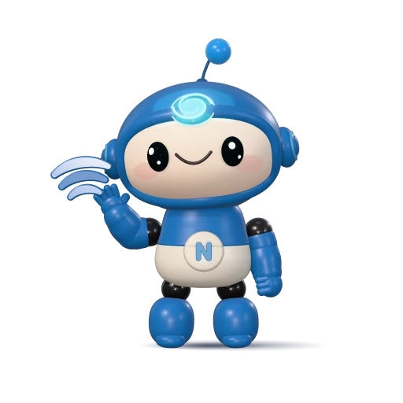
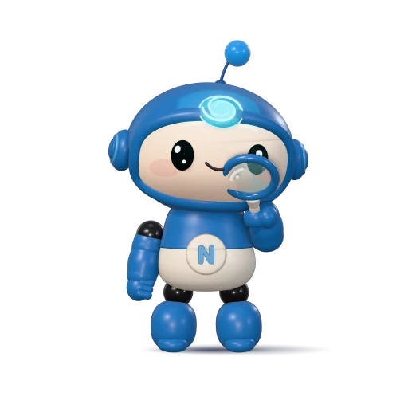
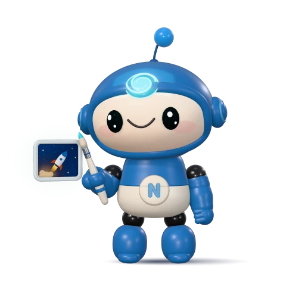
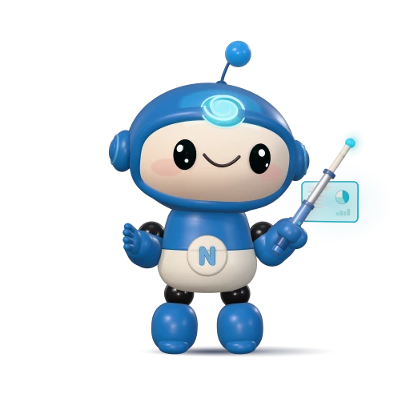
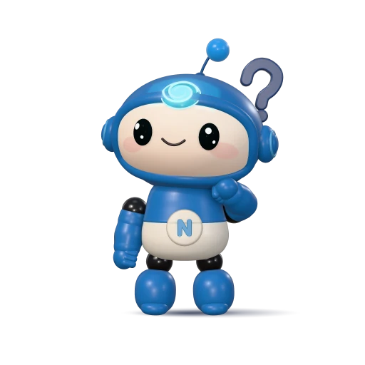
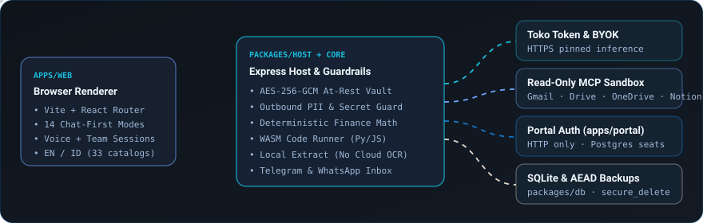

<div align="center">

<a href="AGENTS.md">
  
</a>

<br />

<a href="apps/web/public/brand/logo.png"></a>
&nbsp;&nbsp;
<a href="#how-it-runs">How it runs</a> ·
<a href="#architecture">Architecture</a> ·
<a href="#harnesses">14 Harnesses</a> ·
<a href="#desk-capabilities">Capabilities</a> ·
<a href="#security-and-privacy">Security</a> ·
<a href="#develop">Develop</a> ·
<a href="#documentation-and-maps">Docs &amp; Maps</a> ·
<a href="AGENTS.md"><strong>AGENTS.md</strong></a>

</div>

<br />

**Closed beta.** Nultron is a chat-first hosted web workbench for a one-person company (OPC) on the [Toko Token](https://api.tokotokenai.com) OpenAI-compatible gateway. Each kind of work is one of [14 built-in harnesses](packages/core/src/agents/product-modes.ts) with its own prompt, tools, checks, and exportable output. Custom-agent building stays parked.

> Do not confuse **Toko Token** ([`api.tokotokenai.com`](https://api.tokotokenai.com)) with any other gateway name.

<div align="center">
<table>
  <tr>
    <td align="center"><a href="docs/internal/maps/chat-send.md"><br /><sub><strong>Chat</strong></sub></a></td>
    <td align="center"><a href="docs/internal/maps/research-dossier.md"><br /><sub><strong>Research</strong></sub></a></td>
    <td align="center"><a href="docs/internal/maps/finance-tasks.md"><br /><sub><strong>Finance</strong></sub></a></td>
    <td align="center"><a href="docs/internal/maps/generate-studios.md"><br /><sub><strong>Media</strong></sub></a></td>
    <td align="center"><a href="docs/internal/maps/presentations.md"><br /><sub><strong>Decks</strong></sub></a></td>
    <td align="center"><a href="docs/internal/maps/agent-tools-and-files.md"><br /><sub><strong>Tools</strong></sub></a></td>
  </tr>
</table>
</div>

<p align="center"></p>

## How it runs

Nultron ships as a hosted web app ([**Nultron Enterprise**](docs/internal/release-targets.md#nultron-enterprise)). Ask the operator for an account, open the hosted URL, and sign in through [`apps/portal`](apps/portal) using a username and password (the deploy bundle default) or an e-mailed one-time code (the portal default when `PORTAL_SIGNIN_MODE` is unset). A pasted gateway key remains the floor for model calls, and Enterprise tenants can also connect bring-your-own-key providers via [`packages/core/src/providers/`](packages/core/src/providers). With no gateway key and no portal session, Chat runs in stub demo mode.

Nultron Personal (the retired Electron desktop app, last release `0.15.1` on the archived [`Kyoo032/Nultron-Desktop`](https://github.com/Kyoo032/Nultron-Desktop) repository) was retired on 2026-10-14 and removed from this tree on 2026-11-24. There is no mobile app; see [`docs/mobile.md`](docs/mobile.md). Invited testers see [`docs/closed-beta.md`](docs/closed-beta.md).

## Architecture

<div align="center">
  <a href="docs/internal/maps/README.md">
    
  </a>
</div>

<br />

Quick entry points into the runtime: [`apps/web/server.ts`](apps/web/server.ts) (Express product server), [`packages/host/src/router.ts`](packages/host/src/router.ts) (API router), [`packages/core/src/agents/product-modes.ts`](packages/core/src/agents/product-modes.ts) (mode catalog and fresh-desk rule), [`packages/db/`](packages/db) (Drizzle SQLite schema), and [`webapp-deploy/README.md`](webapp-deploy/README.md) (Docker, Compose, K8s, and AEAD backups).

<p align="center"></p>

## Harnesses

Every fresh desk starts with Chat alone (`FIRST_RUN_MODES = ["chat"]`), and Chat invokes specialist work inline. Full mode catalog: [`docs/product-modes.md`](docs/product-modes.md).

| Harness | What you leave with | Spec | Subsystem map |
|---|---|---|---|
| **Chat** | Conversation with model picker, inline specialist tools, and interactive voice | [`chat.ts`](packages/core/src/harness/modes/chat.ts) | [`chat-send.md`](docs/internal/maps/chat-send.md) |
| **Documents** | A DOCX | [`documents.ts`](packages/core/src/harness/modes/documents.ts) | [`documents.md`](docs/internal/maps/documents.md) |
| **Research** | Sourced notes and a Markdown dossier | [`research.ts`](packages/core/src/harness/modes/research.ts) | [`research-dossier.md`](docs/internal/maps/research-dossier.md) |
| **Finance** | Deterministic figures computed in core and an exportable brief | [`finance.ts`](packages/core/src/harness/modes/finance.ts) | [`finance-tasks.md`](docs/internal/maps/finance-tasks.md) |
| **Data** | Table analysis with the SQL shown | [`data.ts`](packages/core/src/harness/modes/data.ts) | [`data-analysis.md`](docs/internal/maps/data-analysis.md) |
| **Market** | A watchlist briefing | [`market.ts`](packages/core/src/harness/modes/market.ts) | [`market-watch.md`](docs/internal/maps/market-watch.md) |
| **Legal** | A memo, a redline, and a deviation report from uploaded documents | [`legal.ts`](packages/core/src/harness/modes/legal.ts) | [`legal-matter-run.md`](docs/internal/maps/legal-matter-run.md) |
| **Meeting** | A transcript and minutes | [`meeting.ts`](packages/core/src/harness/modes/meeting.ts) | [`meeting-minutes.md`](docs/internal/maps/meeting-minutes.md) |
| **Images** | Generated images | [`images.ts`](packages/core/src/harness/modes/images.ts) | [`generate-studios.md`](docs/internal/maps/generate-studios.md) |
| **Videos** | Generated videos | [`videos.ts`](packages/core/src/harness/modes/videos.ts) | [`generate-studios.md`](docs/internal/maps/generate-studios.md) |
| **Music** | Generated tracks | [`music.ts`](packages/core/src/harness/modes/music.ts) | [`music-mode.md`](docs/internal/maps/music-mode.md) |
| **Edit** | An exported timeline cut | [`edit.ts`](packages/core/src/harness/modes/edit.ts) | [`edit-timeline.md`](docs/internal/maps/edit-timeline.md) |
| **Presentation** | An outline, an HTML preview, and a PPTX | [`presentations.ts`](packages/core/src/harness/modes/presentations.ts) | [`presentations.md`](docs/internal/maps/presentations.md) |
| **Education** | Guided study sessions and structured learning materials | [`education.ts`](packages/core/src/harness/modes/education.ts) | [`education.md`](docs/internal/maps/education.md) |

## Desk capabilities

- **Knowledge Base.** Local ingestion, search, and source-delete cascades in [`packages/host/src/`](packages/host/src) ([`knowledge-flows.md`](docs/internal/maps/knowledge-flows.md), [`knowledge-base-page.md`](docs/internal/maps/knowledge-base-page.md)).
- **Read-only MCP sandbox.** Gmail, Google Drive, OneDrive, and Notion connectors in [`packages/host/src/mcp/`](packages/host/src/mcp) and [`packages/core/src/mcp/`](packages/core/src/mcp) with write, delete, and harness actions blocked before any network call.
- **Interactive Voice.** Voice relay and turn-taking in [`packages/host/src/voice/`](packages/host/src/voice) ([`voice-mode.md`](docs/internal/maps/voice-mode.md)).
- **Virtual agents and Team sessions.** Add or delete specialist agents on `/workspaces` and track delegated runs in [`packages/host/src/delegation/`](packages/host/src/delegation) ([`virtual-agents.md`](docs/internal/maps/virtual-agents.md)).
- **Channels and Customer Inbox.** Pull-only Telegram bots in [`packages/host/src/channels/`](packages/host/src/channels) ([`channels.md`](docs/internal/maps/channels.md)) and WhatsApp inbox in [`packages/host/src/inbox/`](packages/host/src/inbox) ([`customer-inbox.md`](docs/internal/maps/customer-inbox.md)).
- **WASM code runner and local extraction.** Sandboxed Python and JavaScript in [`packages/host/src/code-runner/`](packages/host/src/code-runner) and local document extraction with no cloud OCR in [`packages/host/src/file-extract/`](packages/host/src/file-extract) ([`agent-tools-and-files.md`](docs/internal/maps/agent-tools-and-files.md)).
- **Bilingual UI (EN / ID).** 33 synchronized locale namespaces in [`apps/web/locales/`](apps/web/locales) ([`locale-boot-and-run-harness.md`](docs/internal/maps/locale-boot-and-run-harness.md)).

<p align="center"></p>

## Security and privacy

- **AES-256-GCM at rest.** Message bodies, tool I/O, settings, portal sessions, and knowledge records are encrypted under `AGENTFORGE_SECRETS_KEY` ([`packages/db/src/vault-key.ts`](packages/db/src/vault-key.ts)), backed by AEAD encrypted backups in [`webapp-deploy/scripts/restore.sh`](webapp-deploy/scripts/restore.sh).
- **Outbound PII masking.** [`packages/core/src/security/pii.ts`](packages/core/src/security/pii.ts) and [`pii-id.ts`](packages/core/src/security/pii-id.ts) mask personal and Indonesian identifiers while preserving financial amounts ([`pii-and-key-security.md`](docs/internal/maps/pii-and-key-security.md)).
- **Egress guard.** [`packages/core/src/security/outbound-guard.ts`](packages/core/src/security/outbound-guard.ts) blocks private desk data from leaking into web searches or MCP queries and resource IDs.
- **Transport and hosted perimeter.** Browser traffic and remote inference URLs require HTTPS ([`hosted-security-controls.md`](docs/internal/maps/hosted-security-controls.md), [`docs/internal/security-register.md`](docs/internal/security-register.md)).

Never share your gateway key, and never paste it anywhere except Settings.

## Develop

Read [`AGENTS.md`](AGENTS.md) first. Its [**Where am I?**](AGENTS.md#where-am-i) and [**Where a change goes**](AGENTS.md#where-a-change-goes) sections define branch, folder, guardrail, and test rules.

```bash
pnpm install
pnpm --filter @agentforge/web dev   # http://127.0.0.1:3000 (webdev without portal Postgres)
pnpm test                           # Vitest across all workspace packages
pnpm lint                           # Biome check
pnpm ci:local                       # Full local CI suite (scripts/ci-local.mjs)
```

Root `pnpm dev` also starts [`apps/portal`](apps/portal), which requires `PORTAL_DATABASE_URL`. For a production web build, run `pnpm --filter @agentforge/web build` and deploy through [`webapp-deploy/`](webapp-deploy/README.md).

## Documentation and maps

| Document | Purpose |
|---|---|
| [`AGENTS.md`](AGENTS.md) | Source of truth for coding agents, invariants, CI, and known traps |
| [`docs/internal/maps/README.md`](docs/internal/maps/README.md) | Index of all 52 subsystem architecture maps |
| [`docs/internal/release-targets.md`](docs/internal/release-targets.md) | Active and retired release targets and brand palette rules |
| [`docs/internal/security-register.md`](docs/internal/security-register.md) | Security findings register and deploy checklist |
| [`docs/product-modes.md`](docs/product-modes.md) | Built-in harness catalog and desk presets |
| [`docs/closed-beta.md`](docs/closed-beta.md) | Guide for invited closed-beta testers |
| [`webapp-deploy/README.md`](webapp-deploy/README.md) | Docker, Compose, Kubernetes, and AEAD backup runbook |
| [`lanes.json`](lanes.json) | Path ownership manifest read by [`scripts/lane-guard.mjs`](scripts/lane-guard.mjs) |

## Releases

This repository holds the source for the hosted web app. Deploy bundles (pinned `compose.yml`, `.env.example`, `DEPLOY.md`, `Caddyfile`) and release notes publish to [`Kyoo032/Nultron-Releases`](https://github.com/Kyoo032/Nultron-Releases) through [`scripts/release-web.mjs`](scripts/release-web.mjs). Never clone or push to the release repository by hand.

## Status and license

Closed beta, invite-only access. Feedback from invited testers goes to the operator.

Copyright 2026 Muhammad Rizky Rahmatullah. Licensed under the [Apache License 2.0](LICENSE).
