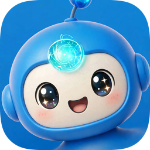

# Release targets

This file lists every product built from this repo, one card per target, covering:

- who it is for and what it ships;
- how it looks: name, logo, mascot, colours, type;
- what is running now, and what to work on next.

**Agents read this file before starting any task.** Name the target your task serves, then keep the change inside it. If the change lands on another target, stop and say so.

Last updated: 2026-10-05 (agentforge `main` at `be2c267`). The hex colours below were sampled from each brand's own logo file.

## At a glance

| Target | Type | Company | Product name | Gateway users see | Status | Focus now |
|---|---|---|---|---|---|---|
| [`nultron-personal`](#nultron-personal) | Desktop app | Public | Nultron | Toko Token | Released v0.15.1; v0.16.0 cut 2026-10-06 | Publish 0.16.0 after the owed drives |
| [`nultron-enterprise`](#nultron-enterprise) | Hosted web app | Nultron Enterprise customers (via DPS) | Nultron | Toko Token + BYOK | Pilot, not deployed | First Tencent deploy, Thu 8 Oct |
| [`hyp-ai`](#hyp-ai) | White-label hosted | Hypernet (XLSMART) | HYP AI | TokenKu | Setting up | Rebrand the clone; plan approval |
| [`kemenkeu-ai`](#kemenkeu-ai) | Desktop flavor | Kemenkeu (Ministry of Finance) | Kemenkeu AI | AIHub | Built locally | Later, after Nultron and HYP AI |
| [`aihub-metranet`](#aihub-metranet) | Desktop flavor | Metranet (Telkom Indonesia) | AIHub Metranet | AIHub | Built locally | Later, after Nultron and HYP AI |

## Scope now (Rizky, 2026-10-05)

**Nultron and HYP AI come first.** Kemenkeu AI and AIHub Metranet come later and get no work until then.

The next milestone is to **simulate pushing one agentforge update into both brands**, to prove the update path before Hypernet gets a VM. Plan:

1. Make one small, real change in agentforge and merge it to `main`.
2. Push it into **Nultron Enterprise**:
   - run `release-web.mjs --dry-run` on the new sha;
   - rebuild the local pilot stack (`webapp-deploy/pilot-local.mjs`) from that sha;
   - check the change is live.
3. Push it into **HYP AI**:
   - export the new sha into `hypey\app`;
   - `git apply --3way --binary hyp-brand.patch`;
   - run the tests;
   - build the images;
   - run them as a stand-in for Hypernet's VM: a local compose stack with its own volumes, then `update.sh <tag>`;
   - check the change is live and the brand survived.
4. Record each step's time, every patch conflict, and what broke. The results decide whether the brand-config build-out (see `hyp-ai` below) is needed now or can wait.

## Which targets a change touches

| Path | Targets |
|---|---|
| `apps/web/**`, `packages/**` | Every target. The renderer and host are shared. HYP AI receives it on its next sync. |
| Code behind `isServerMode()` / `isHostedBuild()` | `nultron-enterprise`, `hyp-ai`. Personal must stay identical, proven by a parity test. |
| `apps/desktop/**` | `nultron-personal`, `kemenkeu-ai`, `aihub-metranet` |
| `apps/desktop/branding/<id>/**` | That one desktop target only |
| `apps/portal/**`, `webapp-deploy/**`, `scripts/release-web.mjs` | `nultron-enterprise`, and `hyp-ai` through its bundle |
| `C:\Users\rizky\hypey\**` (outside this repo) | `hyp-ai` only |
| `apps/mobile/**` | None. It holds rules only, and nothing ships from it. |

## Brand rules for every target

- **Gateway names stay distinct.** Toko Token, TokenKu and AIHub are three different gateways. Never merge or swap their names in copy, catalogs or prompts.
- **White-label brands show TokenKu (Rizky, 2026-10-05).** Users of HYP AI, and of every later white-label brand, see TokenKu as the gateway. Until TokenKu keys exist, the backend of those brands calls the Toko Token endpoint `https://api.tokotokenai.com/v1`. That is a backend setting only; never show the Toko Token name or host in their UI copy. **Nultron keeps Toko Token** as its gateway, in the UI and in the backend (Rizky, 2026-10-05).
- **Each client's art stays in its own build.** A client's logo, mascot or colours never appear in another target's installer, image or screenshots.
- **Never edit a client's logo.** Use the file exactly as received. To shrink a logo, crop it; never redraw it.
- **Copy follows `{productName}` and `{gatewayName}`.** A literal product or gateway name in UI copy is a bug on every other target.

---

## nultron-personal

**Identity**

| Element | Value | Files |
|---|---|---|
| Name | Nultron | `apps/desktop/branding/agentforge/brand.json` (`productName`) |
| Logo | Nultron's painted head on a blue tile | master `apps/desktop/branding/agentforge/source/app-logo.webp`; `logo.png` (256 px, under 200 KB); `icon.ico`, `icon.icns`; favicons in `apps/web/public/brand/`; rail marks `apps/web/components/brand-art/mark-{24,32,48,64}.png` |
| Mascot | Nultron, a 3D robot with a glowing antenna, in 21 states | renders in `apps/web/components/nultron/images/` (`full`, `head`, `clips`, `loops`, `manifest.json`); state table `apps/web/lib/mascot-states.ts`; render scene `tools/nultron-3d` |
| Wordmark | Gradient blue → cyan, rail only (`.wordmark-nultron`) | `apps/web/app/globals.css:2259`, `apps/web/lib/product-brand.tsx` |
| Type | DM Sans (UI) and Source Serif 4 (display), bundled locally | `apps/web/app/globals.css:1-30` |
| Look | Light-first warm desk, blue float, 4 px corners | 0.15.0 design pass |

| Colour | Hex | Role |
|---|---|---|
| Accent (light) | `#0E58F0` | buttons, links, focus |
| Accent (dark) | `#6EA4FF` | the same roles on dark |
| Nultron blue | `#1277C8` | wordmark start, brand art |
| Nultron cyan | `#19BDDC` | wordmark end |
| Cream | `#E4D9CD` | mascot face, warm accents |
| Ink | `#131617` | brand dark |

**Release**

- **Type:** Electron desktop app. It talks to the host over IPC, opens no HTTP port, and keeps SQLite in the user's data dir.
- **Company:** public. Users bring their own Toko Token key.
- **Codebase:** this repo, `main`.
- **Gateway:** Toko Token, pinned to `https://api.tokotokenai.com/v1`.
- **Services:**
  - Windows NSIS installer.
  - macOS dmg/zip, still a preview: nobody has smoke-tested it on a Mac yet.
  - In-app updater reading `Kyoo032/Nultron`.
- **Ships by:** the [pack skill](../../.cursor/skills/pack-nultron/SKILL.md), then `pnpm desktop:release` to the public repo `Kyoo032/Nultron`.
- **Versions:** semver. Published `v0.15.1` (2026-09-28). `0.16.0` cut on 2026-10-06 (branch `chore/release-0.16.0`, [`0.16.0-changelog.md`](0.16.0-changelog.md)), the first Nultron-named installer; not published.
- **Focus now:**
  1. Drive on the packed 0.16.0 app: `run_code`, the folder flow, Start over, and the DPSBuddy → Nultron upgrade on Windows ([`traps.md`](../../.cursor/skills/pack-nultron/traps.md), "First Nultron pack").
  2. Drive SR-112's injected file before publishing.
  3. Publish 0.16.0 with `release-desktop.mjs --require-mac` when Rizky confirms.
- **Logs:**
  - Pack table in the current changelog's `## Pack + publish`; published rows in [`unreleased.md`](unreleased.md).
  - Changelogs: `0.15.x-changelog.md`, `0.16.0-changelog.md`.
  - Public notes: `docs/public/<v>-notes.md`.

## nultron-enterprise

**Identity:** same as [`nultron-personal`](#nultron-personal): name, logo, mascot, colours and type. Differences:

- The portal sign-in pages carry the Nultron logo (`apps/portal/assets/logo.png`) and the product name from portal locale `product`.
- The sender is `DEFAULT_SMTP_FROM` (`apps/portal/src/config.ts:100`).

**Release**

- **Type:** hosted multi-tenant web app: the Express host plus the built renderer, behind Caddy.
- **Company:** Nultron Enterprise customers, priced per user and contacted through DPS. Phase 0 pilot: 10 testers.
- **Codebase:** this repo, `main`.
- **Gateway:** Toko Token (pinned). Server mode adds BYOK keys for Toko Token, OpenAI, Anthropic, Google and OpenRouter, set per company or per person.
- **Services** (one compose stack, `webapp-deploy/compose.yml`):

  | Service | What it is |
  |---|---|
  | `app` | `ghcr.io/kyoo032/nultron-ent`, production dependencies only |
  | `proxy` | Caddy 2.11, TLS and `sign_in_filters`. Restart it together with `app`. |
  | `portal` | `ghcr.io/kyoo032/nultron-portal`, the one-time-code sign-in |
  | `portal-db` | Postgres 16 |
  | `portal-prepare` | one-shot migrations |

- **Where it runs (updated 2026-10-05):** Phase 0 is one Tencent Lighthouse box in Jakarta that will also host dpscloud.co.id (the parent site) and tokotokenai.com. Nultron goes on **nultron-ai.xyz**, with sign-in on **portal.nultron-ai.xyz**. **Never point api.tokotokenai.com at it.** Email is Tencent SES only, for the sign-in codes: "Nultron <no-reply@mail.dpscloud.co.id>", no mailboxes. After a 1-month test, move to a bigger Tencent CVM by sharing a Lighthouse custom image to CVM (same region), restoring the newer data, and switching DNS. Multi-site build: branch `feat/multi-site-edge`. Guide: `nultron-files/deploy/hosting-guide.html`. Before that, Phase 0 was one Tencent Lighthouse box in Jakarta. Phase 1 is TKE; its manifests are in `webapp-deploy/k8s/`, not yet applied.
- **Ships by:** `node scripts/release-web.mjs --tag <tag> --sha <sha>`, with `--dry-run` first. It pushes both images, plus a deploy bundle to `Kyoo032/NultronEnt`.
- **Tag:** `ent-YYYY.MM.DD`. Every deploy is logged by sha.
- **Current:** nothing is released or deployed yet. `Kyoo032/NultronEnt` has no release, and the deploy log is empty.
- **Focus now:**
  1. Build the image, driven with a real hosted Chat.
  2. Dry run of the release.
  3. Release, after Rizky confirms at that moment.
  4. Tencent deploy on Thursday 8 October, logged by sha.
- **Logs:**
  - [Deploy log](web-pivot-2026-09-18.md#deploy-log).
  - [`security-register.md`](security-register.md), the deploy gate.

## hyp-ai

The client's art stays outside this repo, at `C:\Users\rizky\hypey\intake\hypey-hello.png` (4725 × 4725 PNG, Hypey waving).

**Identity**

| Element | Value | Notes |
|---|---|---|
| Name | **HYP AI** | Exactly these letters and that space |
| Company line | Hypernet, an XLSMART company | As printed on Hypey's jacket |
| Logo | **Hypey** | A head-and-helmet crop for favicons and the rail mark. Hypernet's own logomark (the white mark on the helmet) needs their permission first. |
| Mascot | Hypey: a field technician in a teal hard hat and black work jacket, waving | One 2D pose today, which stands in for all 21 states. A 3D render set is planned, built the way `tools/nultron-3d` built Nultron's. |
| Type | Not chosen yet | Inherits DM Sans and Source Serif 4 until Hypernet sends brand guidelines |
| Voice | Not given yet | Use Nultron's plain, friendly voice under the HYP AI name |

| Colour | Hex | Role |
|---|---|---|
| Helmet teal | `#209D84` | fills, gradients, the mascot. About 3.4:1 on white, so never use it for body text. |
| Light teal | `#38B39C` | highlights on dark surfaces |
| Shade teal | `#1F8B7B` | secondary fills |
| Deep teal | `#1C756D` | accent text, buttons and links on light (about 5.5:1 on white) |
| Jacket black | `#282C2D` | ink and dark surfaces |
| App accent (light) | `#0E7565` | in-app text accent and buttons, 5.6:1 on white |
| App accent (dark) | `#3FC4AA` | in-app accent on dark, 8.4:1 |

The two app-accent tokens are the ones the HYP AI build actually uses (`apps/web/app/globals.css` in `hypey\app`); the rest are sampled from the Hypey art.

**Release**

- **Type:** white-label of [`nultron-enterprise`](#nultron-enterprise), hosted only.
- **Company:** Hypernet (XLSMART).
- **Codebase:** agentforge `main`, synced into `C:\Users\rizky\hypey\app` with the brand applied.
  - It has fresh git history.
  - Never edit it by hand: fixes go to agentforge, then a new sync.
  - The source sha is in `hypey\intake\SOURCE_SHA` (`b58383d` on 2026-10-05).
  - Agent files and `docs/internal/` are stripped, with one exception: `docs/internal/portal/migrations/` stays, because the portal reads its shared SQL migrations from there (`apps/portal/src/store/postgres/migrate.ts:30`).
- **Gateway shown to users:** TokenKu, in the demo and in every HYP AI build (Rizky, 2026-10-05).
- **Interim backend:** the backend calls **`https://api.tokotokenai.com/v1`** until TokenKu keys exist, because the only API key available today is a Toko Token key.
  - The switch is two constants, both marked `INTERIM`: the pin in `packages/core/src/gateway/pinned.ts` (URL plus SHA) and `GATEWAY_HOST` in `packages/core/src/gateway.ts`. The tests assert the interim endpoint.
  - Target: `https://api.tokenku.ai/v1`, with SHA `154fd598f550478d375e0ebc28410577f8c978c6b52e39f26d9d9a33523dfb55`.
- **Services:** the same compose stack as Enterprise (app, Caddy, portal, Postgres), branded HYP AI.
- **Where it runs:** a VM that Hypernet provides. Rizky deploys over SSH. The VM is not provisioned yet.
- **Ships by:**
  - *Interim:*
    1. Export agentforge `main` into `hypey\app`.
    2. `git apply --3way` the brand patch.
    3. Test, then commit `Release <tag>`.
    4. Build the images.
    5. Copy the tarball and bundle to the VM and run `./update.sh <tag>`.
  - *Target:* `scripts/release-brand.mjs --brand hypernet`, reading brand data from `brands/hypernet/`. This is not built yet and waits on approval of the plan.
- **Tag:** `hyp-YYYY.MM.DD` (proposed). Each tag maps to one agentforge sha.
- **Rule:** ship only a sha that has already been released and driven as `nultron-enterprise`.
- **Current (end of 2026-10-05):** synced to agentforge b39cdf2 by vendor branch (`hypeyintakeSYNC.md`) and running on :3301. Slides, video, SOP and research were driven live. Deck, 90 s video and DEMO.md were in progress for the 06 Oct demo.
- **Earlier:** the clone was rebranded (2026-10-05) but nothing was committed or released.
  - The brand patch is `hypey\intake\hyp-brand.patch`: 292 files and 13.5 MB, because it carries the logo and mascot binaries.
  - Lint, tsc, and the web, core and host suites pass.
  - Screenshots are in `hypey\intake\screens\`.
- **Not yet rebranded:**
  - "Contact DPS" in the plans copy.
  - `scripts/release-web.mjs` still points at `Kyoo032/*` and `ghcr.io/kyoo032/nultron-*`.
  - Defaults and copyright lines that name Rizky.
- **Behaviour tuned for Toko Token, not yet checked against TokenKu:**
  - The Suno relay.
  - The image and video routes.
  - The model-id preference lists.
  - The wallet and usage endpoints.
- **Focus now:**
  1. Probe TokenKu with a real key: models, image, video, music, usage.
  2. Owner decisions:
     - the brand-config build-out (about 12–14 days);
     - image tarball or a registry;
     - BYOK: TokenKu only, or all five providers;
     - whether Hypernet gets source code;
     - TLS, SMTP and backups;
     - whether to hide the plans page.
  3. Later: the 3D Hypey render set.
- **Docs:**
  - `hypey\intake\BRIEF.md`.
  - `hypey\intake\WHITE_LABEL_PLAN.md`.
  - The visual plan: https://claude.ai/artifact/57kU4X3iAuJY3CiHB1Fh8G.

## kemenkeu-ai

**Identity**

| Element | Value | Files |
|---|---|---|
| Name | Kemenkeu AI | `apps/desktop/branding/kemenkeu/brand.json` |
| Logo | The Kemenkeu emblem: a blue pentagon, gold wings, rice and cotton, and the motto "Nagara Dana Rakça". It is a government emblem: use it unaltered. | `logo.svg` (vector master), `logo.png`, `icon.ico`, `splash.png` in `apps/desktop/branding/kemenkeu/` |
| Mascot | Nultron's, unchanged in the app | There is no flavor mascot |
| Wordmark | Plain product name. The gradient is for Nultron only (`apps/web/app/globals.css:191`). | |
| Type and app colours | Nultron's. A flavor swaps only the name, logo, splash and gateway. | |

| Colour (from `logo.svg`) | Hex | Role in the emblem |
|---|---|---|
| Emblem blue | `#275AB1` | the pentagon field |
| Gold | `#FAB20B` | wings, rice, pillar |
| Green | `#00A650` | the cotton |
| Outline black | `#231F20` | the border |

**Release**

- **Type:** Windows desktop flavor. Packed with `AGENTFORGE_BRAND=kemenkeu node apps/desktop/scripts/pack-brand.mjs`.
- **App id:** `id.go.kemenkeu.ai`. Installer: `Kemenkeu AI Setup <v>.exe`.
- **Gateway:** AIHub, `https://aihub.metranet.co.id/v1`. Metranet runs this gateway.
- **Services:** the installer only. There is no updater, because `updates` is not set.
- **Ships by:** a local pack on Rizky's machine. There is no public release repo.
- **Current:** not recorded. Record the next pack's version, sha and date here.
- **Focus now:** none. Only re-pack when a desktop release needs it.

## aihub-metranet

**Identity**

| Element | Value | Files |
|---|---|---|
| Name | AIHub Metranet | `apps/desktop/branding/metranet/brand.json` |
| Logo | The Metranet logo: a red circle with a white wave "m", the "metranet" wordmark, and "by Telkom Indonesia" with the Telkom mark. Use it unaltered. | `logo.png` (the master). `logo.svg` wraps a raster image, so it is not a true vector. Also `icon.ico` and `splash.png`. |
| Mascot | Nultron's, unchanged in the app | There is no flavor mascot |
| Wordmark | Plain product name | |
| Type and app colours | Nultron's. The flavor swaps only the name, logo, splash and gateway. | |

| Colour (sampled from `logo.png`) | Hex | Role in the logo |
|---|---|---|
| Metranet red | `#E92214` | the circle |
| Wordmark dark | `#202020` | "metra" |
| Wordmark grey | `#808080` | "net" |

**Release**

- **Type:** Windows desktop flavor. Packed with `AGENTFORGE_BRAND=metranet node apps/desktop/scripts/pack-brand.mjs`.
- **App id:** `id.co.metranet.aihub`. Installer: `AIHub Metranet Setup <v>.exe`.
- **Company:** Metranet, a Telkom Indonesia company. It also operates the AIHub gateway that the Kemenkeu flavor uses.
- **Gateway:** AIHub, `https://aihub.metranet.co.id/v1`.
- **Services:** the installer only, with no updater.
- **Ships by:** a local pack on Rizky's machine. There is no public release repo.
- **Current:** not recorded. Record the next pack's version, sha and date here.
- **Focus now:** none.

---

## Keeping this file true

- When you release or deploy a target, update its **Current** and **Focus now** lines in the same change.
- Add a target the day a new company or product is agreed, with its logo file and colours sampled from that file. Never add one in passing.
- When a brand asset moves, update its file path here in the same PR.
- When the "Which targets a change touches" table stops matching the code, fix the table in the same PR.
