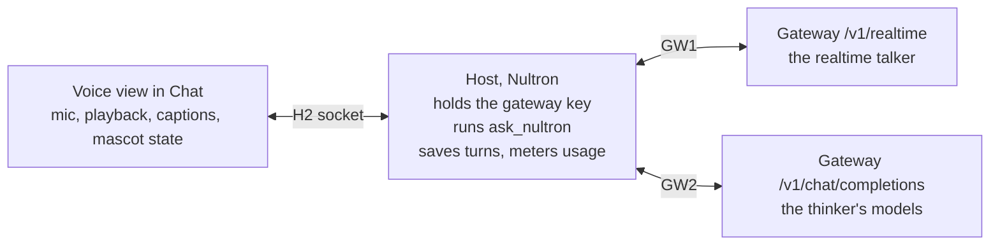
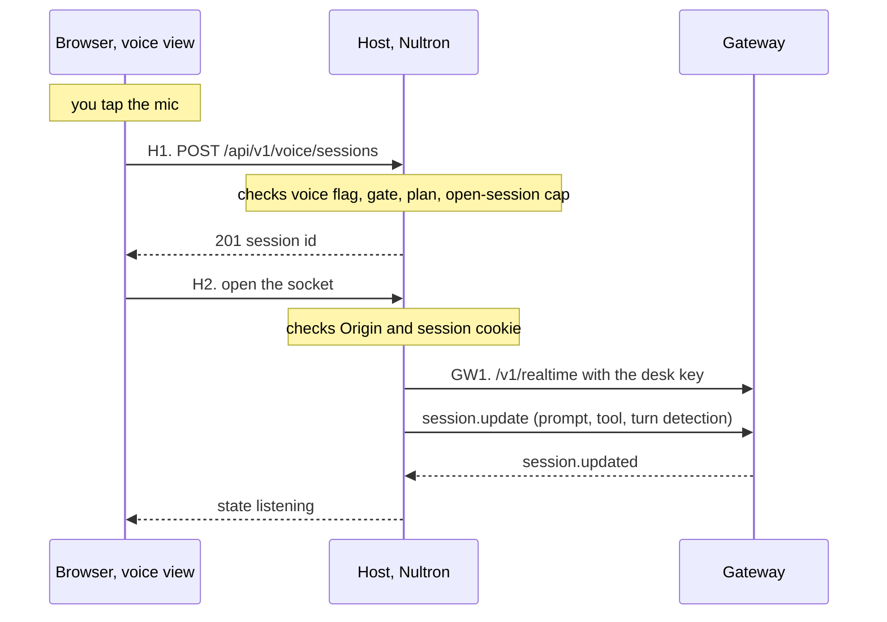
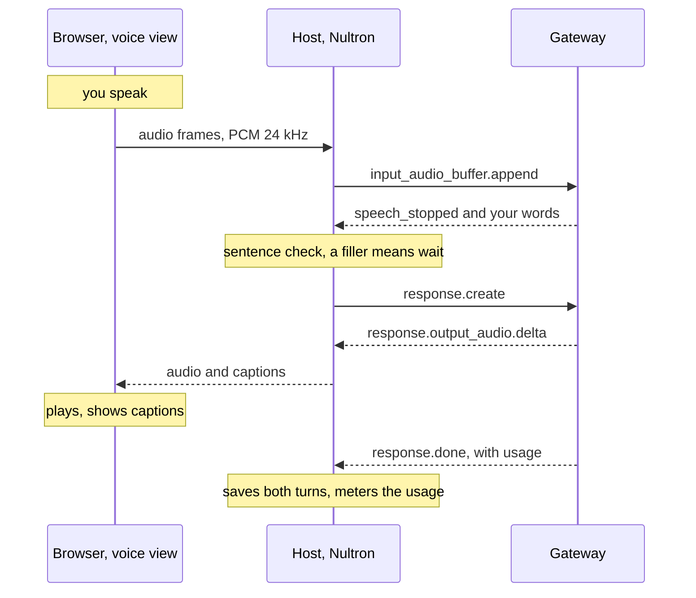
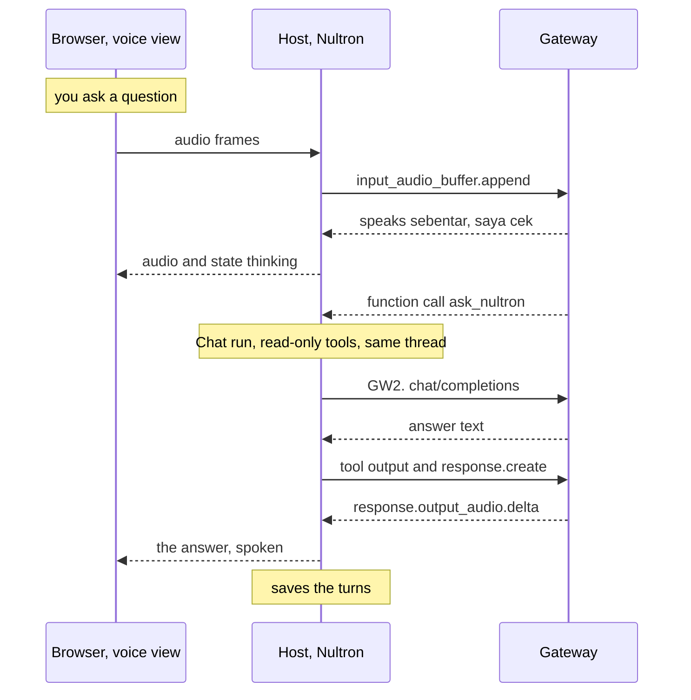
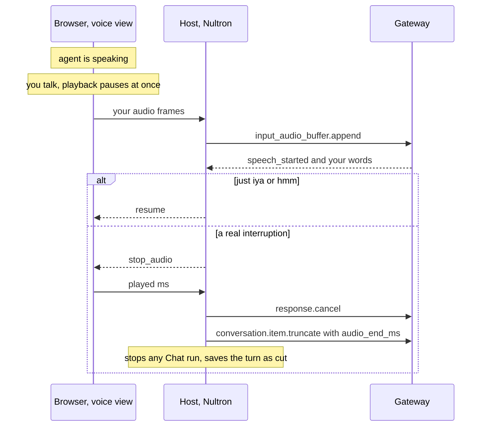
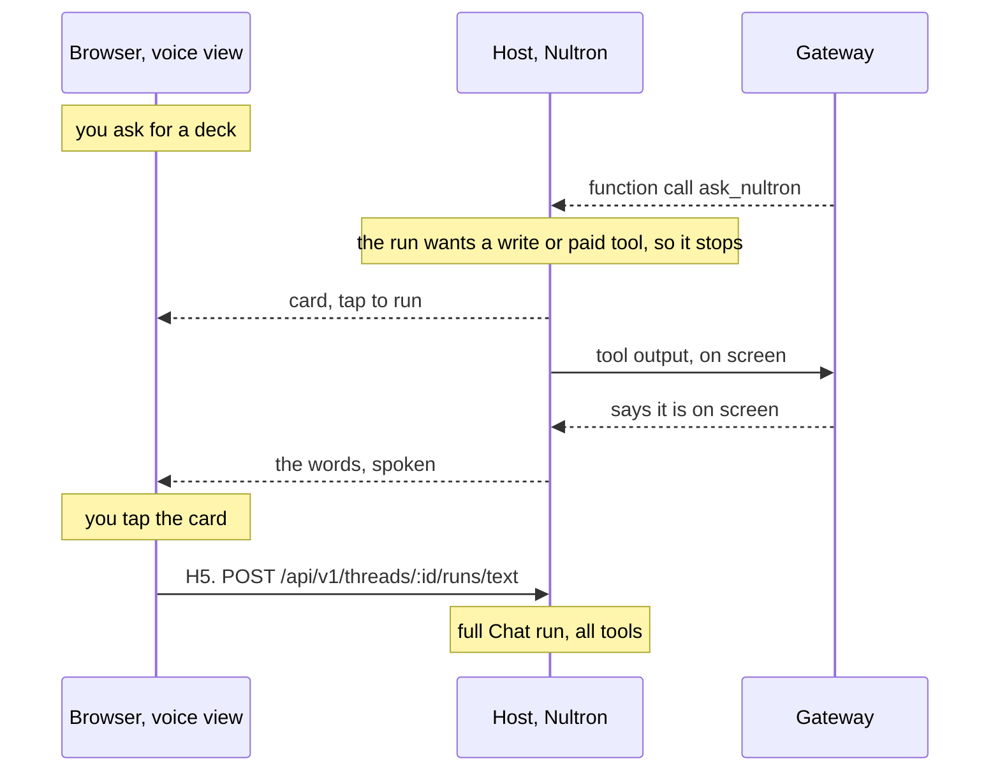
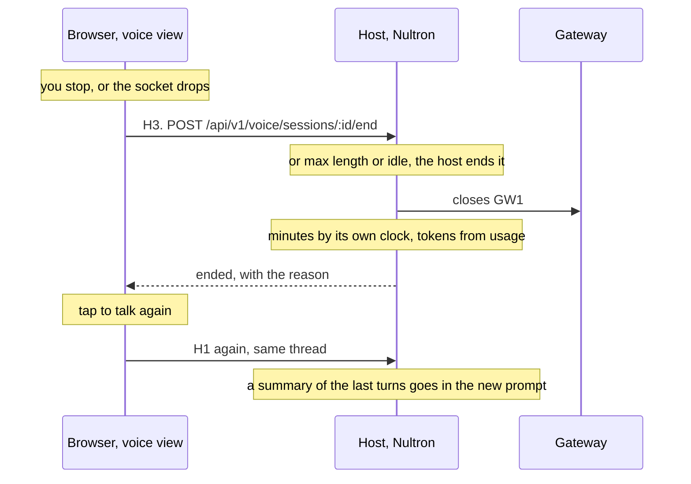
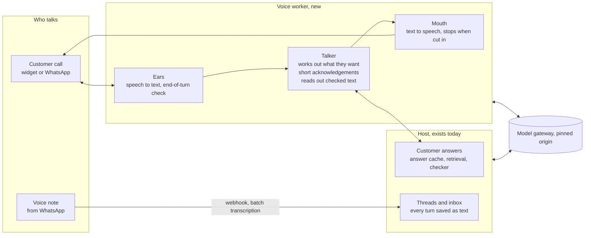
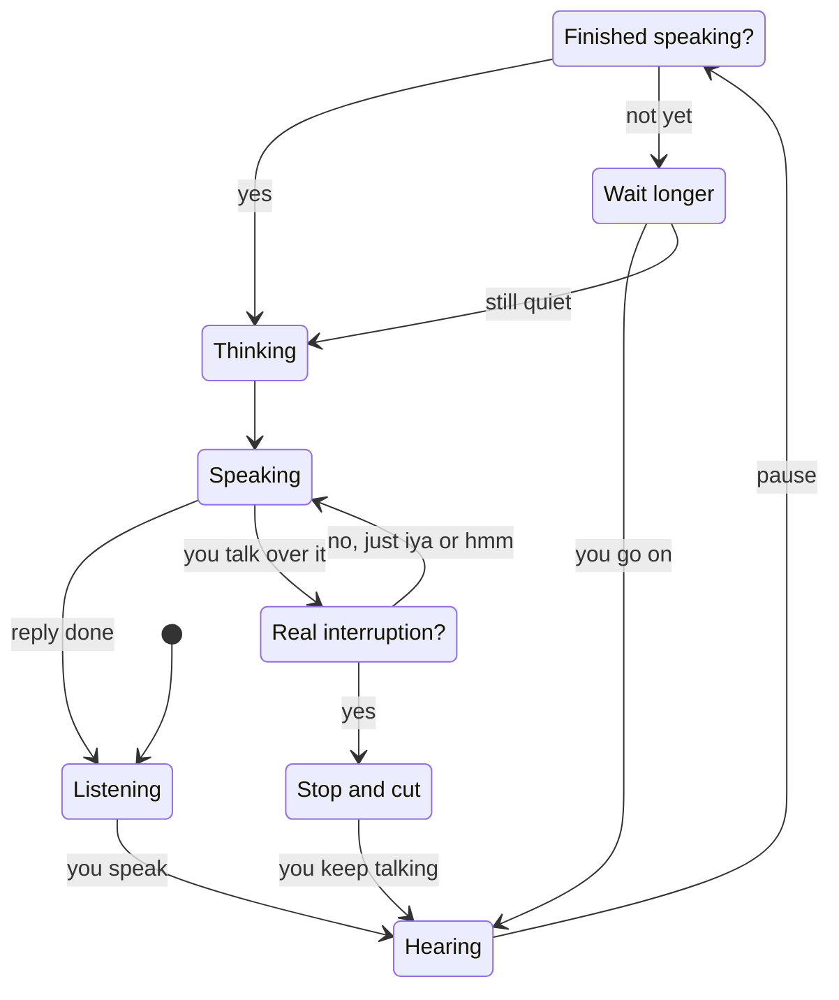

# Nultron Voice Mode Plan

**Status.** Plan for Rizky's review, written 2026-11-05. Nothing here is built. "You" means Rizky, the desk owner. The editable copy with drawn diagrams is the Claude Doc [Nultron Voice Mode Plan](https://claude.ai/artifact/MJpjUELBxkZGQDHnqMVpgL). This file is the repo record, with the diagrams redrawn in Mermaid.

## The answer

Voice mode is live talking inside Nultron, and it is a medium-sized build. You speak to your desk the way you speak to a person. Nultron answers out loud in one to one and a half seconds, waits while you pause mid-sentence, and stops the moment you cut in. WhatsApp and customer calls are later channels on the same engine, not the core.

The design has two roles, a **talker** and a **thinker**.

- **Talker.** A realtime speech model served by the gateway. It hears you, speaks back, says short acknowledgements ("oke, saya cek dulu"), and reads out the thinker's result. The host decides when you have finished and when you really cut in.
- **Thinker.** The Chat run you already have, with its tools, the Knowledge Base and the other workers. Facts and work go through it.

Customer voice, a separate project, splits the talker into ears, a text model and a mouth (a cascade), so every fact can be checked before a customer hears it.

**What you see.** A voice view opens over Chat. The Nultron mascot shows what the agent is doing with states it already has, `listening`, `thinking` and `answering` (`apps/web/lib/mascot-states.ts:12`, `:19`, `:74-81`). Your words and its words stream as captions. Every turn stays in the thread as text, so you can switch between talking and typing at any point.

**One rule gets both speed and accuracy.** The talker never answers a factual or task question from its own memory. It acknowledges at once, hands the question to the thinker, and reads back the thinker's result when it arrives. So you hear something within about a second, and the facts come from the same tools and Knowledge Base Chat uses today. In week one the talker is a speech-to-speech model, which can only be told to follow this rule, so we measure how often it breaks it.

So the answer to "is it a collaboration between voice and text models?" is yes. The voice model listens, speaks and keeps the conversation going. A text model does the real thinking, because text tokens cost far less than audio tokens, and text can be checked and saved.

**Build first.** Week one ships live voice in Chat for you, with a speech-to-speech talker (next section). The cascade engine comes only with customer voice.

## One-week build

**Week one builds all of live voice inside Nultron, and nothing in that scope is left for later.** It is done when every row of the acceptance tests under Expected outcome passes on staging. Customer voice (WhatsApp voice notes, calls, a website widget) is a separate project, because it waits on things no build can do in a week. The five days are a guess, and two gates decide whether any build can pass, Day 0 and Day 1.



The browser never talks to the gateway and never holds its key.

**Why the host carries the audio.** Every model call goes through `api.tokotokenai.com/v1` (your rule, 2026-11-05), and the browser cannot hold the gateway key. So the browser talks only to the host, and the host talks to the gateway. That costs one extra hop and gives the host full control. It runs `ask_nultron` itself, saves every turn, meters usage from the gateway's own usage events, and can end a session at any moment.

**What week one delivers, all of it.**

- The voice view over Chat. A mic button, push-to-talk and hands-free, live captions, the mascot's listening, thinking and answering states, a stop button, and `en` and `id` copy.
- Live talk in Bahasa Indonesia and English through the gateway's realtime model, with the host carrying the audio.
- Turn-taking run by the host. The model reports silence, and the host's sentence check decides whether you have finished, so a pause after "saya mau pesan yang..." gets no answer. Voice detection in the browser pauses the agent the moment you speak. A short "iya" or "hmm" resumes it. Anything longer cancels it and trims the history to what you heard.
- Facts through `ask_nultron`, a read-only Chat run on the same thread, with a short acknowledgement first.
- Work by voice. "Buatkan deck dari riset kemarin" becomes a card. One tap starts it, the talker says it has started, and it reads a short summary when the work is done.
- Every turn saved in the thread as text, so you can switch between talking and typing.
- Phone browsers. A locked screen or a switch to another app ends in a clear message and a one-tap reconnect.
- A voice choice and a language setting.
- Usage metered from the gateway's own usage events and priced at the gateway's rates.
- The guards: an Origin check, the session cookie, an open-session cap, a maximum session length and an idle timeout.
- The eval harness in `packages/host/eval/voice/`, which runs the acceptance tests on demand.

**What is not in week one.** Customer voice, its own project below. The cascade engine, which only customer voice needs.

**How the host runs turn-taking.** OpenAI's Realtime protocol lets the host switch off the model's own reply and its own interruption, through `turn_detection` with `create_response: false` and `interrupt_response: false` ([client events reference](https://developers.openai.com/api/reference/resources/realtime/client-events), read on 2026-11-05). The model still reports `speech_started` and `speech_stopped`. On a stop, the host reads the transcript. An Indonesian filler ("eh", "anu", "jadi", "terus") or an unfinished sentence means it waits for more. Otherwise it sends `response.create`. A fast text model judges the sentence only when the word rules cannot decide. If the gateway's model ignores these two options, end of turn falls back to the model's own detection, and requirement 4 cannot pass. Day 0 checks this.

**Five lanes in parallel.** Each lane owns its own files, so no two writers touch the same file. The paths are proposals. All work happens in the tester sync worktree on `tester/chat-first`. Every day ends with one integrated build and an eval run, and a lane counts as done only when it passes on the integrated tree.

| Lane | Owns | Builds |
| --- | --- | --- |
| A. Relay | `packages/host/src/voice/` session, relay and gateway client, plus the router entries | H1, H2, H3, the realtime client, the session lifecycle, caps, metering |
| B. Voice view | `apps/web/components/voice/`, `apps/web/lib/voice-*`, `apps/web/locales/*/voice.json` | The voice view, browser voice detection, playback with pause and resume, phone reconnect, settings |
| C. Thinker | `packages/host/src/voice/ask.ts` and the read-only tool set | `ask_nultron`, tap cards, progress and summaries for work started by a tap |
| D. Turn-taking | `packages/host/src/voice/turns.ts` | The sentence check, the backchannel filter, cancel and trim |
| E. Proof | `packages/host/eval/voice/` and the test set | The acceptance runner and the daily numbers |

**Day by day.**

| Day | Who | What | Gate |
| --- | --- | --- | --- |
| Before day 1 | You and the gateway team | Day 0. The gateway key check, a realtime session tested in Indonesian, proof that the gateway relays `create_response` and `interrupt_response`, the model-square requests. You record the test set with consent, about 200 short utterances. | **Go or no-go.** No Indonesian realtime model on the gateway means the week does not start. |
| 1 | Lane E, then all | The bake-off of every working candidate on the test set. Lanes A to E start their skeletons. | **Go or no-go.** If the best model misses the speed row, the week stops and you choose a faster model from the model square or a different threshold. |
| 2 | All lanes | Each lane's core on its own files. The first integrated build and eval run. You restart `:3000`. | The integrated build talks end to end |
| 3 | All lanes | Work by voice, phone reconnect, settings, priced metering. The second eval run and the bug list. You restart `:3000`. | Every acceptance row has a number |
| 4 | All lanes | Fixes until every row passes on webdev. The security rows, the map page, the feature recipe, language parity, `ci:local`. You restart `:3000`. | All rows pass on webdev, `ci:local` green |
| 5 | You, then all | Your go to deploy to staging. The full acceptance run on staging, then your own test drive. Fixes, then the branch pushed and the promotion pull request opened. | All rows pass on staging, and you approve the pull request |

**What the week needs from you.** The gateway key and Day 0, with the gateway team. About an hour to record the test set. A restart of `:3000` on days 2, 3 and 4. Your go for the staging deploy. Your test drive, and your approval of the promotion pull request.

**If Day 0 fails.** A walkie-talkie version can still be built on the gateway's transcription and speech routes, but it cannot meet "seamless and fast", so it does not count as week one done. It waits for your decision.

**Risks.**

1. New API, the software the gateway runs, relays WebSockets only with "a compatible upstream and channel configuration" ([its README](https://github.com/QuantumNous/new-api)). Day 0 proves it.
2. The realtime model may ignore `create_response: false` or `interrupt_response: false` through the gateway. Day 0 proves it.
3. Nobody has measured speed through the host, the gateway and an overseas upstream. Day 1 measures it.
4. Browser voice detection can hear the agent's own voice and stop it. So the barge-in tests run on laptop speakers, not headphones.
5. The talker can be told to call `ask_nultron`, not forced to. The thinker-skipped row measures it.
6. The relay runs in the host process. That is fine for one owner.

## Model-square requests

These go to the gateway team, in this order. Each one names the route it needs on `api.tokotokenai.com/v1` and how we prove it works.

| # | Model | Route on the gateway | Why | How we test it |
| --- | --- | --- | --- | --- |
| 1 | A Qwen realtime model already in the catalog, `qwen3.5-omni-flash-realtime` first | `/v1/realtime` | May need only a working channel, not a new model | Day 0. A session opens, Indonesian in and out, held 5 minutes |
| 2 | `gpt-realtime-mini`, or OpenAI's current realtime model | `/v1/realtime`, OpenAI Realtime protocol | Mature tool calls, turn detection, and trimming on interruption | Day 1 bake-off |
| 3 | Grok Voice (`grok-voice-latest`) through an OpenAI-compatible channel | `/v1/realtime` | $0.08 per minute flat in your research, same protocol | Day 1 bake-off. Indonesian is unproven. |
| 4 | A text-to-speech model with Indonesian voices, for example `gpt-4o-mini-tts` | `/v1/audio/speech`. The route exists, but no speech model is reachable today (`packages/host/src/selectable-models.ts:213`). | The walkie-talkie fallback, fixed phrases, and the cascade for customer voice | 20 Indonesian sentences with numbers and names |
| 5 | A transcription model, for example `gpt-4o-mini-transcribe` | `/v1/audio/transcriptions`. The route exists. | The walkie-talkie fallback, voice notes in Phase 4, the cascade | Word error rate on the test set |
| 6, ask if possible | Gemini Live | Google's own Live protocol, not `/v1/realtime` | The only speech-to-speech family that lists Indonesian | Needs a new gateway feature |
| 7, ask if possible | GPT-Live (`gpt-live-1`) | `/v1/live/sessions` plus a WebRTC offer relay | Listens while it speaks | Needs a new gateway feature |

## Workflows and endpoints

Week one adds three host endpoints and uses three gateway routes. Everything else already exists. The host holds the gateway key, and the browser talks only to the host.

| # | Endpoint | Called by | What it does | Answers |
| --- | --- | --- | --- | --- |
| H1 | `POST /api/v1/voice/sessions` (new) | Browser, when you tap the mic | Checks the voice flag, the gate, your plan and the open-session cap, then creates the session | `201 {sessionId, model, maxSeconds}`. Refusals: `403 voice_disabled`, `403 gateway_blocked`, `429 voice_session_limit`, `503 voice_model_unavailable`. |
| H2 | `GET /api/v1/voice/sessions/:id/stream` (new, WebSocket upgrade) | Browser, right after H1 | Carries your audio in, and the agent's audio, captions and state out. Checks the session cookie and the Origin itself, because an upgrade skips the CSRF path. One socket per session, a frame size cap, an idle timeout. | The frames below |
| H3 | `POST /api/v1/voice/sessions/:id/end` (new) | Browser, on stop. Closing the socket does the same. | Ends the session. Calling it twice changes nothing. | `200 {minutes}` |
| H5 | `POST /api/v1/threads/:id/runs/text` (exists, `packages/host/src/router.ts:333`) | Browser, when you tap a card | The normal Chat run with all its tools | The SSE stream, as today |
| H6 | `GET /api/v1/settings` (exists) | Browser, on load | Gains `voice.enabled`, which shows or hides the mic | As today |
| GW1 | `GET wss://api.tokotokenai.com/v1/realtime?model=<id>` (gateway) | Host only, with the desk's key | The realtime talker, on the OpenAI Realtime protocol | The events below |
| GW2 | `POST https://api.tokotokenai.com/v1/chat/completions` (gateway, used today) | Host, inside the `ask_nultron` Chat run | The thinker's models | As today |
| GW3 | `POST /v1/audio/transcriptions` and `POST /v1/audio/speech` (gateway) | Host, in the walkie-talkie fallback | Speech to text, and text to speech | Depends on the model square |

H2 and H3 answer `404` for another person's session and join the tenancy harness, like the inbox's by-id routes. On 2026-11-05 the gateway answered `401` rather than `404` on GW1 and GW3 when called without a key, so those routes exist. Whether a model stands behind them is Day 0's question.

**Frames between the browser and the host (H2).** Audio goes both ways as binary frames of 16-bit PCM at 24 kHz mono, the OpenAI Realtime default. The host sends JSON frames `state` (listening, thinking or speaking), `caption` (who said it, the text, final or not), `card` (a write or paid step to tap), `stop_audio` (drop what is queued) and `ended` (why). The browser sends `played` (how many milliseconds of the agent's audio you heard) and `stop`.

**Events between the host and the gateway (GW1).** These come from [OpenAI's Realtime server events reference](https://developers.openai.com/api/reference/resources/realtime/server-events), read on 2026-11-05. The host listens for `session.updated`, `input_audio_buffer.speech_started`, `input_audio_buffer.speech_stopped`, `conversation.item.input_audio_transcription.completed`, `response.output_audio.delta`, `response.output_audio_transcript.delta`, `response.function_call_arguments.done` and `response.done`, which carries usage. The host sends `session.update`, `input_audio_buffer.append`, `conversation.item.create` with the tool's output, `response.create`, `response.cancel` and `conversation.item.truncate` with `audio_end_ms`. The client event names except the last are not yet checked against a page, and the gateway relays whatever its upstream sends, so Day 0 confirms every name.

**The data shapes.**

```ts
type VoiceSession = {
  id: string;
  deskId: string;
  ownerId: string;
  threadId: string;
  model: string;
  startedAt: number;
  endsBy: number;
  ended?: {
    at: number;
    reason: "user" | "max_length" | "idle" | "dropped" | "error";
    minutes: number;
    usage: { inputTokens: number; outputTokens: number };
  };
};

type HostFrame =
  | { type: "state"; value: "listening" | "thinking" | "speaking" }
  | { type: "caption"; role: "user" | "assistant"; text: string; final: boolean }
  | { type: "card"; card: { action: string; summary: string } }
  | { type: "stop_audio" }
  | { type: "ended"; reason: string };

type BrowserFrame = { type: "played"; ms: number } | { type: "stop" };

type AskResult =
  | { kind: "answer"; text: string; sources: { title: string; ref: string }[] }
  | { kind: "needs_tap"; text: string; card: { action: string; summary: string } }
  | { kind: "refused"; reason: "gateway_blocked" | "timeout" };
```

Sessions live in host memory. Each one ends at `endsBy` by the host's own clock, whether or not H3 arrives, so a closed tab never holds a slot. The open-session cap counts only sessions still open, and a restart ends them all.

**Endpoints for customer voice.** These are proposals, so names may change when that project is designed.

| Phase | Endpoint | What it does |
| --- | --- | --- |
| 4 | `GET /api/v1/voice/stream` on the voice worker, upgraded to a WebSocket behind Caddy | The cascade's audio path. The relay moves out of the host process. |
| 4 | Streaming speech-to-text and text-to-speech on the gateway | Requested for the model square when customer voice is designed |
| 4 | Graph `GET /{media-id}` and the media upload | A customer's voice note in, a spoken reply out. The inbox branch has neither today. |
| 4 | The WhatsApp calls webhook field | Calls arrive on a field the inbox parser skips today (`whatsapp.ts:226` on the branch) |
| 4 | A public route for the website voice widget | Gets its own security review, like the WhatsApp webhook |

### W1. Starting a session



Refusals: `403 voice_disabled`, `403 gateway_blocked`, `429 voice_session_limit`, `503 voice_model_unavailable`.

The gateway key never leaves the host. If any check fails, no session is made and the gateway is never called.

### W2. A plain spoken turn



Your audio passes through the host to the gateway. The model reports silence, and the host decides whether you have finished. Only then does it ask for a reply. The host relays the reply and saves both sides, with the usage from `response.done`.

### W3. A turn that needs facts



The talker says a short acknowledgement, then calls `ask_nultron`. The host runs the Chat run itself, read-only, through the gateway, and returns the answer as the tool's output for the talker to speak. On this protocol the talker waits for the tool, so the acknowledgement rests on a prompt rule that Day 1 tests. Meanwhile the host's thinking state keeps the mascot moving.

### W4. Cutting in



Voice detection in the browser pauses the agent the instant you speak, without waiting for a round trip. The host then reads what you said. A short "iya" or "hmm" resumes the paused audio. Anything longer cancels the reply, trims it to what you heard, and stops any running Chat run.

### W5. A write or paid request



Voice never starts a write or a paid step on its own. The host stops the Chat run before such a tool and sends you a card. Your tap starts the normal Chat run through H5. The talker says the work has started, and reads a short summary when it is done.

### W6. Ending, drops and reconnects



The host ends a session on your stop, at its maximum length, after an idle spell, or when the socket drops. It meters from the gateway's usage events, which it now sees itself. A reconnect is a new session on the same thread, with a short summary of the last turns in its prompt.

## The cascade engine, for customer voice

Customer voice uses this engine, because every fact for a customer must be checked before it is spoken. Week one does not need it.



Your voice streams from the voice view into the voice worker. The ears turn it into text and decide when you have finished. The talker handles the conversation itself and passes anything factual or any task to the Chat run, which does the work with its tools, the Knowledge Base and the other workers. The talker speaks the result back, and every turn lands in the thread as text. The dashed parts are later channels for your customers, on the same engine.

## The turn loop



A pause alone never ends a turn. When the person stops talking, the agent also checks whether the sentence sounds finished. "Saya mau pesan yang..." is not finished, so it waits longer. "Ada kopi susu?" is finished, so it answers at once. When the person talks over the agent, its voice pauses right away. A short "iya" or "hmm" lets it carry on. Anything longer cancels the reply, and the history keeps only the words the person actually heard.

In week one the host makes both decisions in this picture. The gateway's model reports silence, and the host's sentence check answers "Finished speaking?". The browser pauses the agent the moment you speak, and the host answers "Real interruption?" from what you said.

## Your five requirements

Each requirement maps to a mechanism we can build and measure. The targets are proposals to test in the spikes, not measurements.

| You asked for | How the design meets it | Target to prove |
| --- | --- | --- |
| 1. Know what the person wants | Each turn takes one route from a short fixed list (a question, a task for a worker such as research or a deck, a change that becomes a tap card, small talk, unclear). The routing test checks the route each turn takes, because a realtime talker answers in speech, not with a label. Simple requests such as "ulangi", "pelan-pelan" or "stop" are handled by the talker alone, with no thinker call. When the intent is unclear, the talker asks one short question instead of guessing. | Intent right on at least 90% of a labelled Indonesian test set |
| 2. Seamless, fast, about 90% accurate | Every stage streams. Retrieval starts on the partial transcript while the person is still talking. If the thinker needs more than a moment, the talker says a short acknowledgement first. Speech starts on the first checked sentence, not the whole answer. Accuracy comes from the thinker. The talker never answers a factual or task question from memory. It hands it to the Chat run, which uses its tools and the Knowledge Base. | First audio within 1.5 s of the person finishing (p50), under 2.5 s (p90). 1 s at p50 is the stretch target. |
| 3. As few tokens as possible | The thinker gets only the transcript, never audio. The talker's prompt is short and fixed, so the provider can cache it. History is a rolling summary plus the last few turns. Fixed phrases such as acknowledgements are spoken from cached audio, with no model call. The model runs once per finished turn, never on partial words. | Tokens per minute of talk, tracked per stage, falling release over release |
| 4. Know when they have finished, and let them cut in | Three layers decide the end of a turn in week one (W2). Voice activity detection runs in the browser. A semantic check reads the transcript and asks whether the sentence is complete (Indonesian fillers like "eh", "anu", "jadi" and "terus" mean they are not done). A maximum silence ends the turn regardless. For barge-in, the browser's echo cancellation keeps the agent from hearing itself. Speech over the agent pauses its voice at once. A short "iya", "oke" or "hmm" resumes it. Anything longer cancels the model and the voice and trims the history to the words actually heard. | Agent cuts in on under 5% of turns. Voice stops within 300 ms of a real interruption. |
| 5. The right model | A realtime talker from the gateway, with the Chat run as thinker. The Models section has the candidates, and the day 1 bake-off picks one. | Picked by a bake-off on Indonesian audio, not by reputation |

**Two safety rules come with barge-in.** First, an action that changes something (sending an email, changing a file, starting a paid step) never runs from voice alone. In week one the voice tool can only read, and a write or a paid step appears on screen for you to tap. Later phases add a spoken yes, so a cut-in can never leave half an action done. Second, cancelling builds Chat's first real stop path. Chat has no stop control today. A run ends only on a watchdog timeout, a closed connection, or the page unloading (`apps/web/components/chat-composer.tsx:525-553`, `packages/host/src/runs.ts:278-296`).

## Models

Week one's talker is a realtime speech-to-speech model served by the gateway, because that is the only design that can be built in a week and still meet the speed test. The cascade, with each stage picked by a bake-off on Indonesian audio, is for customer voice, where each fact must be checked before it is spoken. Prices and support below are from vendor pages our research pass read on 2026-11-05. Latency figures are vendor or third-party numbers, not measured from Jakarta.

**Your rule (2026-11-05).** Nultron uses only models the gateway serves at `api.tokotokenai.com/v1`. A model named in this section that the gateway lacks is a model-square request, not a vendor integration, and its price is the gateway's rate, not the list price below.

| Option | First audio after the person stops | Indonesian | Fit for Nultron |
| --- | --- | --- | --- |
| Cascade (speech-to-text, text model, text-to-speech) | About 0.9 to 1.5 s, an estimate summed from vendor stage figures | Best model chosen per stage | For customer voice. The checker, PII masking and tools all work on text. |
| Speech-to-speech, for example [gpt-realtime-2.1](https://developers.openai.com/api/docs/pricing) or [Gemini 3.8 Live](https://aistudio.google.com/docs/pricing) | 0.97 to 1.21 s for the large models, 4.28 s for gpt-realtime-2.1-mini on high reasoning ([Artificial Analysis](https://artificialanalysis.ai/models/speech-to-speech), about July 2026) | Only Gemini lists `id` officially ([Live API](https://aistudio.google.com/docs/live-api/capabilities)) | Week one's talker, through the gateway. Facts come from the thinker, never from the talker's own memory. |
| Hybrid, a speech-to-speech talker with a text thinker | Same as speech-to-speech for small talk | As above | This is week one's design. Facts that must be right still need a pause ([LiveKit](https://livekit.com/blog/talker-reasoner-pattern-voice-agents)). |

**Week one pick.** Only a realtime model the gateway serves. The cached catalog of 2026-10-06 lists `qwen3.5-omni-flash-realtime`, `qwen3.5-omni-plus-realtime`, `qwen-audio-3.0-realtime-flash` and `qwen3-omni-flash-realtime`. None has been opened by our code, and their Indonesian speech is unproven. Day 0 tests them. If none speaks Indonesian well, the model-square requests decide the pick. The per-stage cascade picks below are for customer voice, also through the gateway.

**First candidates per stage.**

| Stage | Through the gateway (try first) | Upstream model to request for the model square |
| --- | --- | --- |
| Speech-to-text, live | Unknown. The cached catalog (2026-10-06) lists `qwen-audio-3.0-realtime-flash` and `qwen3.5-omni-flash-realtime`, never opened by our code. Spike 1 finds out. | [Deepgram Nova-3](https://developers.deepgram.com/docs/models-overview), lists Indonesian and is meant for batch or streaming, though its language table does not separate the two. $0.0077 per minute. [ElevenLabs Scribe v2 Realtime](https://elevenlabs.io/pricing/api), about 150 ms, $0.39 per hour. Deepgram Flux has no Indonesian. |
| Speech-to-text, voice notes | The Meeting batch chain, headed by `gemini-3.5-flash` and `mimo-v2.5-asr`. Never proven against the live gateway. | [gpt-4o-mini-transcribe](https://developers.openai.com/api/docs/pricing), $0.003 per minute |
| End of turn | Runs on our side, no gateway | [LiveKit turn detector](https://docs.livekit.io/agents/logic-structure/turns/turn-detector/) `v1-mini` lists Indonesian among 14 languages and runs on CPU. [Pipecat Smart Turn v3.2](https://github.com/pipecat-ai/smart-turn) lists Indonesian among 23, about 8 MB, BSD-2. Neither publishes an Indonesian accuracy figure for the current model. Customer voice measures it. |
| Talker | The fast tier: `deepseek-v4-1-flash`, then the Gemini and GPT mini or flash models in the catalog | None needed |
| Thinker | Chat's daily and reasoning tiers, unchanged | None needed |
| Text-to-speech | Unknown. The cached catalog lists `qwen3-tts-instruct-flash-realtime`, never opened. | [ElevenLabs Flash v2.5](https://elevenlabs.io/docs/overview/models), Indonesian, about 100 ms, $0.04 per 1,000 characters. [Cartesia Sonic 3.6](https://docs.cartesia.ai/build-with-cartesia/tts-models/latest), Indonesian. [Google Chirp 3 HD](https://docs.cloud.google.com/text-to-speech/docs/chirp3-hd), id-ID voices, streaming. |

**Voice runtime.** Two ways to run the live loop, settled by a one-day prototype of each in the customer-voice project.

- **Our own worker** over a WebSocket. Silero VAD (MIT) runs in the browser, and an end-of-turn model runs in the worker. It needs no UDP ports and no new vendor, but we write the barge-in logic ourselves.
- **[LiveKit Agents](https://github.com/livekit/agents-js)** in Node (Apache-2.0). It ships VAD, turn detection, barge-in handling and plugins for most vendors above. It needs a LiveKit server, either self-hosted with UDP ports on the shared box (a deploy change) or LiveKit Cloud ($0.01 per minute after 1,000 free minutes, a new destination for audio). Pipecat is the other mature framework, but it is Python only, a second runtime.

## Your research, compared

Your research (`voice-calling.md`, 2026-11-05) and this plan reach the same design. A realtime speech model talks, and text models think through a tool that does not block. That is the GPT-Live pattern you describe, and it is what week one builds with `ask_nultron` (W3). Your research adds two talker candidates and several lessons for customer calls. It differs from the plan in three places.

| Your finding | Matches the plan? | What changes |
| --- | --- | --- |
| Hybrid: a realtime talker, with hard work handed to text models without blocking | Yes, this is week one (W3) | Nothing |
| Claude has no speech-to-speech API, so Claude voice is a cascade | Yes | Claude stays usable as a thinker model through the gateway |
| GPT-Live (`gpt-live-1`) listens while it speaks, with no separate turn detector | New | Day 1 tests it. It may fix week one's two weak spots, a pause mid-sentence and a short "iya". [OpenAI's WebRTC guide](https://developers.openai.com/api/docs/guides/voice-webrtc?api=realtime) confirms the model id, and the server sets up the session, so no token reaches the browser. |
| Grok Voice: $0.08 per minute flat, OpenAI Realtime-compatible, SIP, 25+ languages | New | Day 1 tests it. [xAI's voice page](https://docs.x.ai/developers/model-capabilities/audio/voice) confirms browser tokens but lists no languages, so Indonesian is unproven. One OpenAI-protocol adapter could serve both OpenAI Realtime and xAI. |
| LiveKit Agents as the default orchestration | Partly, it is decision V10 | Week one still connects straight to the provider, because LiveKit needs UDP ports on the shared box or LiveKit Cloud as a new destination for audio. LiveKit becomes the default if V10 picks it. |
| Deepgram Nova-3 with `language=id`, then ElevenLabs or Cartesia, for the cascade | Yes, customer voice | Your fallback rule joins customer voice: switch to the cascade when the realtime model is unhealthy or mishears Indonesian. |
| Telephony lessons: µ-law audio, fixed wording for disclosures, a parallel transcript for the record | New | Added to Phase 4 |

**Where we differ.**

- **When phone calls come.** Your rollout puts telephony in week 4. This plan puts customer voice after the inbox is live, the answer pipeline is built, and you decide the customer-audio questions. Those are gates in this repo, not engineering time.
- **Latency.** Your cascade budget totals 0.8 to 1 s. From the Jakarta box, each stage is a round trip to a vendor outside Indonesia, so this plan's acceptance test asks for 1.5 s at p50 and 2.5 s at p90, and day 1 measures whether the gateway can meet it.
- **Prices.** Your note says GPT-Live's $0.05 per minute comes from pricing summaries, and I could not confirm it. Grok's $0.08 is from the xAI models page you cite. The xAI voice page I read states no price.

**Every candidate comes through the gateway.** GPT-Realtime and Grok Voice speak the OpenAI Realtime protocol that the gateway's `/v1/realtime` route relays, so one host adapter covers both once the gateway serves them. Gemini Live and GPT-Live use other protocols that the gateway would have to add. Week one ships one talker. A second one later is a new adapter in the host, not a new endpoint.

## Tokens and cost

A 5-minute live conversation costs roughly 7 to 21 US cents on list prices when the prompt cache hits, and up to about 80 cents when it misses on a long history. A voice note costs well under a cent to transcribe. These are estimates from list prices, not measurements. The assumed call has 10 turns, 2 minutes of the person speaking, 2 minutes of the agent speaking, and a 2,000-token prompt.

These are upstream list prices. Through the gateway each model costs Toko Token's rate, which this plan has not checked.

| Setup | 5-minute call (estimate) |
| --- | --- |
| gpt-realtime-2.1-mini (speech-to-speech) | about $0.07 |
| Cascade (Nova-3, a small text model, ElevenLabs Flash v2.5) | about $0.12 |
| Gemini 3.8 Live, no context compression | about $0.14 |
| gpt-realtime-2.1, prompt cache hits | about $0.21 |
| gpt-realtime-2.1, cache misses on a long history | about $0.80 |
| GPT-Live, $0.05 per minute (pricing summaries in your research, unconfirmed) | about $0.25 |
| Grok Voice, $0.08 per minute flat (xAI models page, from your research) | about $0.40 |

On list price the mini speech-to-speech model is the cheapest. Week one uses whichever realtime model the gateway serves that passes the day 1 bake-off, at Toko Token's rate. The cascade comes with customer voice because its facts can be checked, not because it is cheaper per minute. Day 1 reruns this table with our own minutes.

**Where the money goes.** In the cascade, the text model sees only the transcript, a few dozen tokens per turn. Speech-to-text and text-to-speech per minute are the main costs. In speech-to-speech, the agent's own audio output is the biggest line, and history is billed again on every turn. So the cost rules are these.

- Short spoken answers. The agent says the answer, then offers more.
- A fixed prompt prefix, so cached input applies. Cached audio input on gpt-realtime-2.1 is $0.40 per million tokens against $32 uncached.
- Fixed phrases such as acknowledgements are spoken from cached audio, with no model call.
- The text model runs once per finished turn, never on partial words.
- Voice metering is added in week one, because audio is not priced in usage today.

## Infra

Voice adds one new part, a voice worker that holds no data, beside the host. Everything that stores data stays in the host.

**In week one there is no voice worker.** The host relays the audio. The browser opens a WebSocket to the host, and the host opens one to the gateway's `/v1/realtime` with the desk's key. The content security policy likely needs no change, because current browsers count a same-origin `wss:` connection under `'self'`. That is an inference, checked on day 2. The relay runs in the host process in week one, which is fine for one owner, and moves to the voice worker when customer voice is built. The table below is the engine after week one.

| Part | Runs on | Holds | Why there |
| --- | --- | --- | --- |
| Mic, echo cancellation, voice activity detection, playback | The browser | Nothing | Echo cancellation only works at the mic. Detection in the browser costs the 2 vCPU box nothing. Stopping playback locally makes a cut-in instant. |
| Voice worker (new, customer voice) | A second process or container on the Jakarta box | One session's audio, in memory only | It holds the long-lived audio connections and streams to the speech models. The host is one process on one SQLite file (SR-29, SR-66), so long connections stay out of it. The worker calls the host over loopback for tools, Knowledge Base search and saving turns. |
| Host (exists) | The same box | Threads, transcripts, the inbox, settings, keys | Same role as today. It runs the gate, tenancy, tools, the checker and metering. |
| Speech-to-text, talker, text-to-speech | Through the gateway where possible | Nothing of ours after the call | A new vendor only by your decision (below). |

**Connections.**

- For customer voice, browser to worker is a WebSocket over HTTPS. Caddy proxies WebSockets as they are. Audio travels as small 16 kHz frames. WebRTC (UDP plus a TURN server) comes in only if mobile networks measure too slow or too lossy.
- The new route needs four things the host lacks today. It needs an upgrade handler (none exists), its own Origin check (an upgrade is a GET, so it skips the CSRF path), the session cookie, and a cap on open voice sessions per desk. Chat holds one of six run slots for a whole stream, so voice needs its own cap.
- Live customer calls need media transport (WebRTC or SIP, UDP ports, TURN). That changes the deploy path and the Lighthouse firewall, so it waits for your word.

If LiveKit wins decision V10, the browser speaks WebRTC to a LiveKit server instead of a WebSocket to our worker. That needs either UDP ports on the shared box, which is a deploy change, or LiveKit Cloud, which is a new destination for audio.

**Phones.** Most people will talk to Nultron from a phone browser. The mic works there over HTTPS, but on most phones a locked screen or a switch to another app cuts the audio. The voice view must notice a dropped session, say so, and reconnect with one tap.

**Vendor egress is a policy call, not a model pick.** Today a desk's content may leave the box only for the gateway, the portal and Telegram, each on a pinned origin. A raw voice carries a name, a number, maybe an address, and PII masking cannot redact audio. Sending it to a new speech vendor (Deepgram, ElevenLabs, Cartesia) adds a destination. Your rule settles it (2026-11-05). Every model call goes through the gateway, and a missing model is requested for the model square.

**What the repo already has.**

| Piece | Where | Use for voice |
| --- | --- | --- |
| Mic capture with permission and format checks | `apps/web/lib/meeting-recorder.ts`, `meeting-recorder-media.ts` | Reuse the checks. Live voice needs small frames, not a recording file. |
| Microphone allowed on hosted | `packages/host/src/security-headers.ts:85`, `webapp-deploy/Caddyfile:158` | Ready in code. Never confirmed live (SR-14). |
| Batch transcription across gateway models | `packages/host/src/meeting/transcribe.ts`, `packages/core/src/meeting/asr-model.ts` | Fits WhatsApp voice notes. Too slow for live turns. |
| Streaming replies and abort to the gateway | `packages/host/src/runs.ts`, `packages/core/src/runtime/ai-sdk-runtime.ts` | The thinker's path. Needs a stop the person can trigger. |
| Model tiers (fast, daily, reasoning) | `packages/core/src/models/tiers.ts` | The talker uses the fast tier. |

**What is missing.** There is no WebSocket and no realtime client. Realtime model ids are excluded on purpose (`packages/core/src/models/audio-capabilities.ts:88`). No speech output is reachable (`packages/host/src/selectable-models.ts:213`). Audio is not metered by price (`packages/host/src/usage-record.ts:94-96` returns `no_list_price`), so "fewer tokens" cannot be measured until voice metering exists.

## Customer voice, a separate project (Phase 4)

Customer voice is your customers reaching your desk by voice: WhatsApp voice notes, WhatsApp calls, a voice widget on a website. It is not part of week one, and nothing in week one waits on it. It needs four things no build can do in a week.

- The WhatsApp inbox live in prod. It waits for your go ([PR #198](https://github.com/Kyoo032/Nultron/pull/198)).
- The answer pipeline with its checker, so a customer only ever hears checked facts ([PR #197](https://github.com/Kyoo032/Nultron/pull/197), not merged).
- Meta business verification, and Meta's calling terms for your number. Calling needs a daily limit of at least 2,000 unique recipients.
- Your decisions on customer audio, listed under Decisions.

It reuses week one's voice view and relay. Because every fact for a customer must be checked before it is spoken, it uses the cascade engine described below, with every stage through the gateway. Once the four gates clear, it gets its own plan and its own acceptance tests.

**From your research, for customer calls.** Phone audio is 8 kHz µ-law, so pass it through to a model that accepts it, or resample once at the edge. Say required wording, such as "this is an automatic assistant", with fixed text-to-speech, never through the talker. Keep a parallel transcript for the record. A WhatsApp call is not just another SIP trunk, because Meta has its own auth, eligibility and media rules, so prototype it early.

## Expected outcome and acceptance tests

After week one you talk to Nultron live in Chat, in Bahasa Indonesia or English. It waits while you pause mid-sentence, lets a short "iya" pass, stops when you really cut in, answers facts from your own desk, and starts work you ask for with one tap.

**Week one is done when every row below passes on staging.** The rows come from your five requirements. Every threshold is a proposal for you to confirm, or to replace with your own criteria. Each number is reported with its run count and its spread.

| Your requirement | Test | Pass (proposed) |
| --- | --- | --- |
| 1. Knows what you want | 100 labelled utterances in Indonesian and English: questions, work requests, changes, small talk, unclear. The session's action is checked against the label. | At least 90% routed right. Every write or paid request becomes a card, 100%. |
| 2. Seamless and fast | 50 live turns on staging, on laptop speakers | First audio after you finish within 1.5 s at p50 and 2.5 s at p90. On a fact turn, the acknowledgement within 1.2 s at p50. |
| 2. About 90% accurate | 50 factual questions against a seeded Knowledge Base, judged by a model through the gateway and spot-checked by you | At least 90% correct and drawn from the desk. The talker answers a fact without `ask_nultron` in under 5% of fact turns. |
| 3. As few tokens as possible | The same 50 turns | Tokens per minute at or under the budget set on day 1. No model call on partial words. |
| 4. Knows when you finished | 40 utterances with a pause mid-sentence and Indonesian fillers | The agent cuts in on 5% or fewer |
| 4. Can be cut in | 30 real interruptions and 30 backchannels ("iya", "hmm", "oke"), on laptop speakers | The voice pauses within 300 ms in at least 95% of real interruptions. A backchannel stops the reply in 10% or fewer. The thread keeps only the words you heard, 100%. |
| 5. The right model | The day 1 bake-off record | The chosen model is served by the gateway and passes every row above |
| It holds up | A 15-minute session, a phone screen lock and reconnect, a second session over the cap | All three behave as designed |
| It ships | Language parity, `ci:local`, the security rows, the map page and the feature recipe | All green |

**The test set.** About 200 short utterances, roughly an hour of recording, made with consent by you or the team before day 1. Synthetic Indonesian audio would need a speech model the gateway does not have yet. The set never includes a real customer's voice. The runner lives in `packages/host/eval/voice/`, is dev only and never ships.

## Future development

Each part stays swappable. The talker is one adapter, the thinker is the Chat run, and customer voice adds the cascade. Most of what comes later is a swap or an addition, not a rewrite.

- **Customer voice.** WhatsApp voice notes and live customer calls reuse the same engine once the inbox is live and the answer pipeline is built (Phase 4).
- **A brand voice per desk.** The owner picks a voice from a list. A cloned voice only with the speaker's consent, and only by your decision.
- **Voice in the other workers.** Live notes in Meeting, a Market briefing read aloud, a routine that calls the owner with a morning summary.
- **Telegram voice notes** into the same inbox. Telegram drops voice messages today (`packages/host/src/channels/telegram.ts`, around line 272).
- **Urgency detection.** An angry or urgent tone moves a conversation to Needs you faster.
- **Regional languages.** Javanese and Sundanese, if the bake-off finds a model that handles them.
- **Outbound calls.** Reminders and follow-ups that the business starts. Meta charges for these and its policy limits them, so they come last.
- **A phone number** through a SIP trunk, for businesses that do not use WhatsApp calling.
- **A learning loop.** Each owner correction updates the answer cache, so the next caller hears the corrected answer at zero model cost.

## Decisions for Rizky

V2 is decided. V3 and V10 are not needed in week one. If you say "go" without answering, the default applies.

| # | Question | Default |
| --- | --- | --- |
| V1 | Start with live voice inside Nultron, customers later? | Decided by you on 2026-11-05. Yes. |
| V2 | Speech models only through the gateway, or may a direct speech vendor receive voice? It would be a new destination for desk content. | Decided by you on 2026-11-05. Only models the gateway serves. A missing model is requested for the model square. |
| V3 | May a voice worker run as a second process or container beside the host? It is a deploy change. | Yes. It keeps no data and talks to the host over loopback. |
| V8 | Free or paid? | Live voice in Nultron metered like Chat on every plan. Customer calls on paid plans only, because they need extra infrastructure. |
| V9 | Voice stays inside Chat, as a voice view opened from the composer's mic, not a new mode? | Yes |

**V10, the voice runtime.** Our own worker over a WebSocket, or LiveKit Agents with a LiveKit server? Prototypes in the customer-voice project decide it. Until then the default leans to our own worker on the shared box, because it needs no UDP ports and no new vendor.

**Customer voice decisions wait for Phase 4.** They are whether a model may read a customer's voice, whether their audio is kept after transcription, how to reply to a voice note, and whether a website widget or WhatsApp calling comes first. Deleting audio after transcription would depart from your 2026-11-03 rule to keep customer messages until erased. User-started WhatsApp calls are free to the business, but calling needs a number with a daily limit of at least 2,000 unique recipients.

## Security register rows

Proposed rows for `docs/internal/security-register.md`. Numbers are assigned when each phase lands, as the WhatsApp plan did.

| Row | Severity | Lands in | Guards |
| --- | --- | --- | --- |
| Raw voice goes to a speech model or vendor, and PII masking reaches neither the audio nor, in week one, the answers spoken back | High | Week one, customers in Phase 4 | Gateway only, your rule of 2026-11-05. Audio and spoken answers pass the gateway unmasked, under Toko Token's retention policy. No customer audio before Phase 4. |
| A WebSocket upgrade route skips the CSRF path | High | Week one | Its own Origin check, the session cookie, a cap on open sessions per desk, a frame size cap, an idle timeout |
| Customer audio and transcripts are personal data | Medium | Phase 4 | Whether audio is kept is decided with Phase 4. The transcript is covered by Erase this customer, Start over and desk deletion. Logs carry counts only. |
| Live call media opens UDP ports and a TURN server on the shared box | High | Phase 4 | Your word on the deploy change, short-lived TURN credentials, call caps |

## WhatsApp inbox status

Phase 1 of the WhatsApp customer inbox is built, tested and pushed, but it is not merged or deployed. It has been paused since 2026-11-03, waiting for your go on the production rollout. The draft is [PR #198](https://github.com/Kyoo032/Nultron/pull/198) on branch `claude/project-thread-mhx9za`. Its last commit is `839e716`, from 2026-11-03.

| Part | State |
| --- | --- |
| Customers page, signed public webhook, three new tables (migration `0023`) | Built. The PR reports 92 host inbox tests and 7 hosted-adapter tests passing, and a Chromium drive against a local sandbox. Not rerun for this plan. |
| Retention | No expiry and no trim. The owner can **Erase this customer**, and that is the only way a message is removed. |
| Security rows | SR-191 to SR-194 are written. |
| Live test with Meta | Never done. |
| Production rollout | Not started, on purpose. The steps are: merge into `tester/chat-first`, open a promotion PR, set two env vars, add a proxy rule for the webhook path, get past the preview gate, check Meta's test number, and check Graph `v23.0`. |
| Phase 2 (an agent drafts or sends replies) | Not started. The answer pipeline it needs is still a plan ([PR #197](https://github.com/Kyoo032/Nultron/pull/197), unmerged). |

**What voice needs from it.** A customer's voice note arrives today as the fixed label `[voice note]`. The parser throws away the media id on purpose (`packages/host/src/inbox/whatsapp.ts:262-269` on the branch). The client has no media download or upload. The schema allows only `text` and `unsupported` messages. The webhook also does all its work before it answers Meta, so transcription must run after the 200 or Meta will retry. A WhatsApp call arrives on a different webhook field, which the parser skips today (`whatsapp.ts:226`).

**Open for you on WhatsApp.** First, the go for the production rollout. You said you would test the inbox only in prod. Second, erase does not reach backups (SR-193).

## Sources

Pages our research pass opened on 2026-11-05. Repo facts are cited by `file:line` where they appear.

- OpenAI. [API pricing](https://developers.openai.com/api/docs/pricing), [Realtime VAD](https://developers.openai.com/api/docs/guides/realtime-vad), [Realtime conversations](https://developers.openai.com/api/docs/guides/realtime-conversations), [Realtime API blog](https://developers.openai.com/blog/realtime-api), [gpt-realtime-whisper](https://developers.openai.com/api/docs/models/gpt-realtime-whisper), [Agents SDK voice agents](https://openai.github.io/openai-agents-js/guides/voice-agents/)
- Google. [Gemini pricing](https://aistudio.google.com/docs/pricing), [Gemini deprecations](https://aistudio.google.com/docs/deprecations), [Live API capabilities](https://aistudio.google.com/docs/live-api/capabilities), [Chirp 3 HD voices](https://docs.cloud.google.com/text-to-speech/docs/chirp3-hd)
- Amazon. [Nova 2 Sonic language support](https://docs.aws.amazon.com/nova/latest/nova2-userguide/sonic-language-support.html)
- Deepgram. [Pricing](https://deepgram.com/pricing), [Models overview](https://developers.deepgram.com/docs/models-overview), [Changelog, October 2026](https://developers.deepgram.com/changelog/2026/10/5.md)
- ElevenLabs. [API pricing](https://elevenlabs.io/pricing/api), [Models](https://elevenlabs.io/docs/overview/models), [Speech to text](https://elevenlabs.io/docs/overview/capabilities/speech-to-text)
- Others. [Soniox pricing](https://soniox.com/pricing), [Soniox Indonesian](https://soniox.com/speech-to-text/use-cases/voice-agents/indonesian), [AssemblyAI pricing](https://www.assemblyai.com/pricing.md), [Cartesia models](https://docs.cartesia.ai/build-with-cartesia/tts-models/latest), [Cartesia pricing](https://cartesia.ai/pricing), [Artificial Analysis speech-to-speech](https://artificialanalysis.ai/models/speech-to-speech)
- Turn taking and runtimes. [Silero VAD](https://github.com/snakers4/silero-vad), [LiveKit turn detector](https://docs.livekit.io/agents/logic-structure/turns/turn-detector/), [LiveKit adaptive interruptions](https://docs.livekit.io/agents/logic/turns/adaptive-interruption-handling.md), [Pipecat Smart Turn](https://github.com/pipecat-ai/smart-turn), [LiveKit pricing](https://livekit.com/pricing), [LiveKit agents-js](https://github.com/livekit/agents-js), [LiveKit server](https://github.com/livekit/livekit), [Pipecat](https://github.com/pipecat-ai/pipecat), [Talker and reasoner pattern](https://livekit.com/blog/talker-reasoner-pattern-voice-agents)
- WhatsApp. [Cloud API calling](https://developers.facebook.com/docs/whatsapp/cloud-api/calling), [Calling pricing](https://developers.facebook.com/documentation/business-messaging/whatsapp/calling/pricing/), [Media](https://developers.facebook.com/documentation/business-messaging/whatsapp/business-phone-numbers/media/)
- Cost math and research. [Realtime cost per minute (third party)](https://callsphere.ai/blog/vw2c-openai-realtime-cost-per-minute-math-2026), [Commercial ASR study, May 2026](https://arxiv.org/abs/2605.19069)

Also used: Rizky's research note `voice-calling.md` (2026-11-05) and its sources, plus two pages read to check it, [OpenAI's Realtime WebRTC guide](https://developers.openai.com/api/docs/guides/voice-webrtc?api=realtime) and [xAI's voice docs](https://docs.x.ai/developers/model-capabilities/audio/voice).

For the gateway rule: [New API's README](https://github.com/QuantumNous/new-api) and [OpenAI's Realtime server events](https://developers.openai.com/api/reference/resources/realtime/server-events). The gateway's routes were probed without a key on 2026-11-05: `/v1/realtime` and `POST /v1/audio/*` answered `401`, an unknown path answered `404`.
