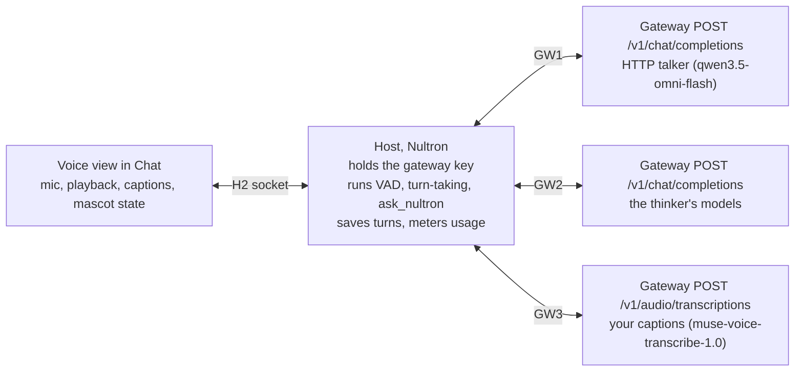
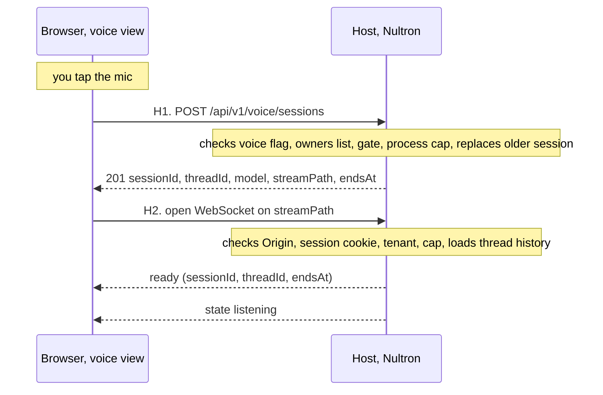
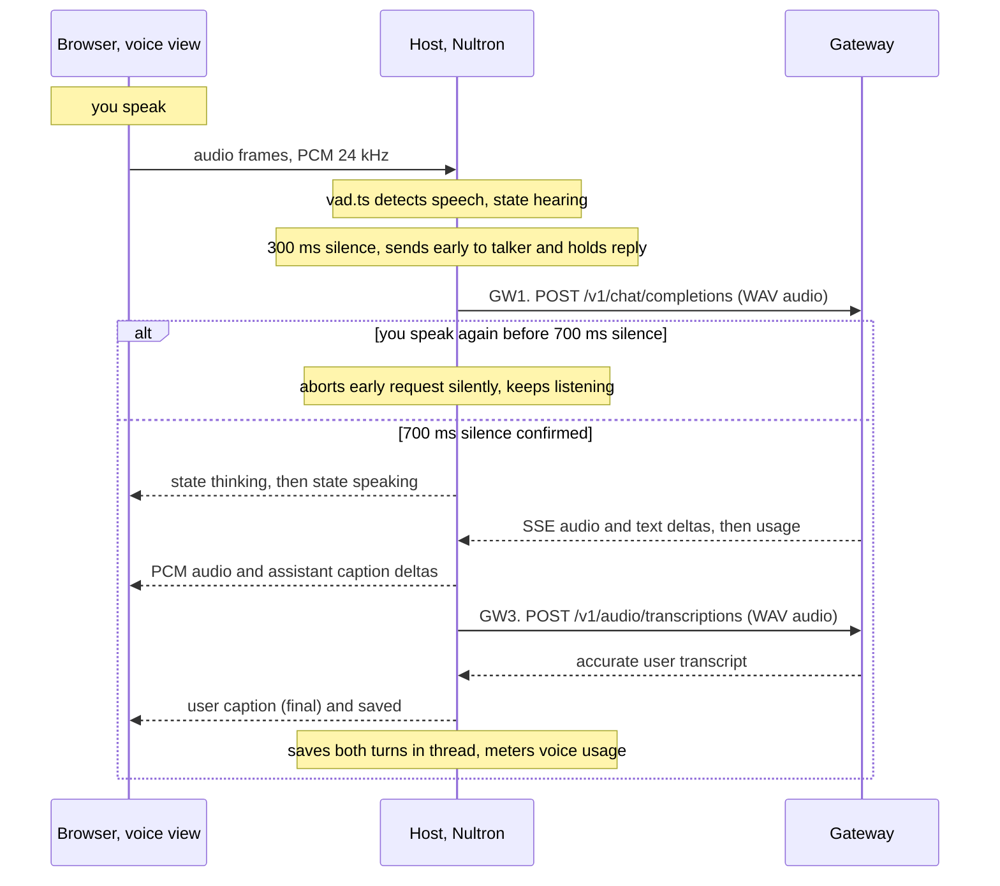
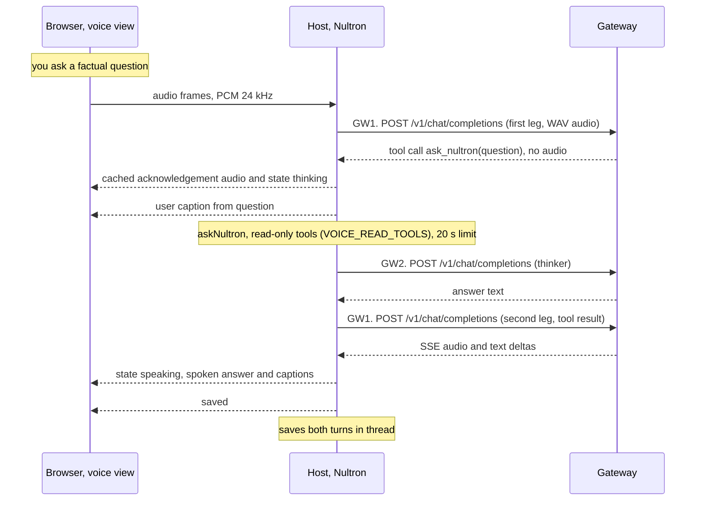
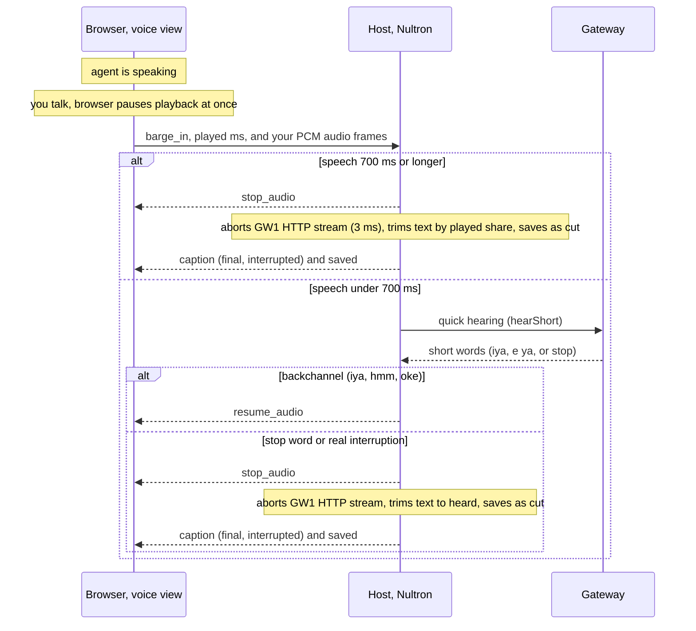
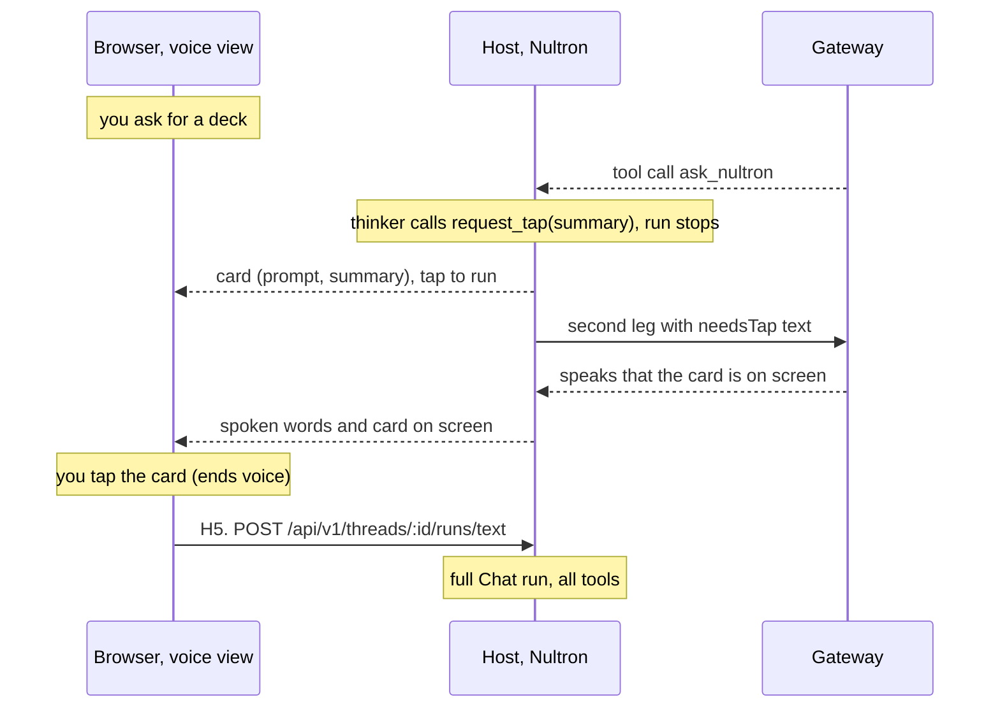
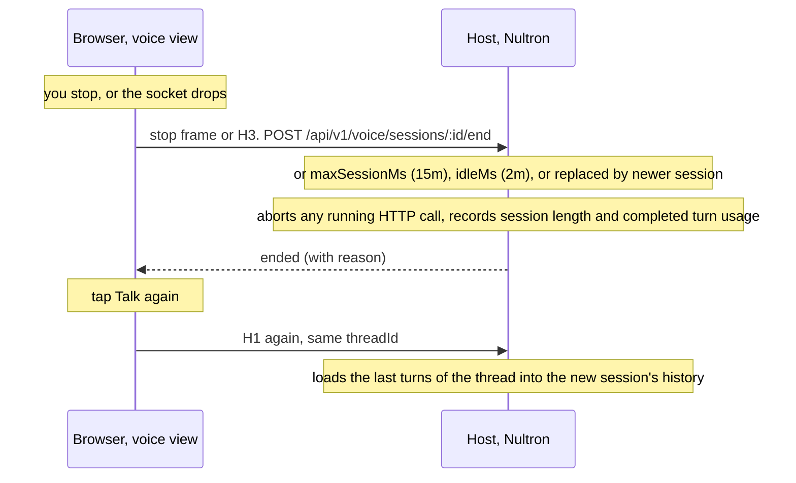
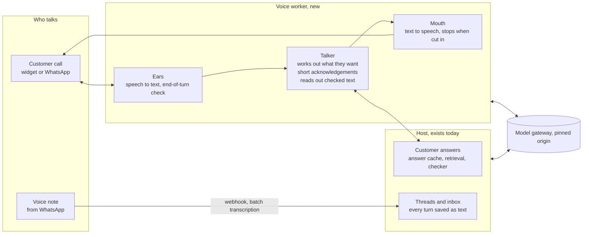
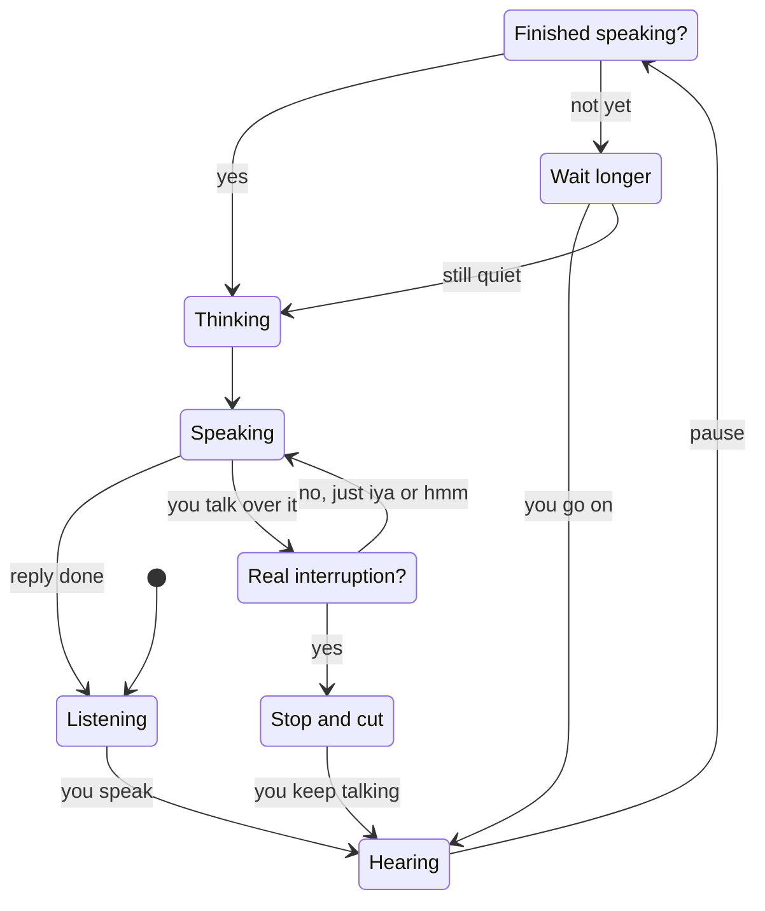

# Nultron Voice Mode Plan

**Status.** Updated 2026-11-10 after Day 0; week one is being built on tester lane branches and is not merged or deployed. "You" means Rizky, the desk owner. The editable copy with drawn diagrams is the Claude Doc [Nultron Voice Mode Plan](https://claude.ai/artifact/MJpjUELBxkZGQDHnqMVpgL). This file is the repo record, with the diagrams redrawn in Mermaid.

## The answer

Voice mode is live talking inside Nultron, and it is a medium-sized build. You speak to your desk the way you speak to a person. Nultron answers out loud in about one to one and a half seconds on short utterances, waits while you pause mid-sentence, and stops the moment you cut in. WhatsApp and customer calls are later channels on the same engine, not the core.

The design has two roles, a **talker** and a **thinker**.

- **Talker.** A speech-to-speech model served by the gateway (`qwen3.5-omni-flash`, voice `Tina`). On 2026-11-10 the gateway refused realtime WebSockets for this account, so week one uses an HTTP streaming talker behind one interface (`packages/host/src/voice/talker.ts`). It hears your finished utterance, speaks back, calls `ask_nultron` when a turn needs your desk, and reads out the thinker's result. The host runs voice detection and decides when you have finished and when you really cut in.
- **Thinker.** The Chat run you already have, with its read-only tools and the Knowledge Base. Facts go through it, and work that writes, costs money or takes long becomes a card you tap to run in Chat.

Customer voice, a separate project, splits the talker into ears, a text model and a mouth (a cascade), so every fact can be checked before a customer hears it.

**What you see.** A voice view opens over Chat. The Nultron mascot shows what the agent is doing with states it already has, `listening`, `thinking` and `answering` (`apps/web/lib/mascot-states.ts:12`, `:19`, `:74-81`). The agent's words stream with its voice, and your words arrive as a caption shortly after. Every turn stays in the thread as text, so you can switch between talking and typing at any point.

**One rule gets both speed and accuracy.** The talker never answers a factual or task question from its own memory. It calls `ask_nultron`, the host plays a short cached acknowledgement ("Sebentar, saya cek dulu.") at once and runs the thinker, and the talker reads back the thinker's result when it arrives. So you hear something within about a second, and the facts come from the same tools and Knowledge Base Chat uses today. In week one the talker is a speech-to-speech model, which can only be told to follow this rule, so we measure how often it breaks it.

So the answer to "is it a collaboration between voice and text models?" is yes. The voice model listens, speaks and keeps the conversation going. A text model does the real thinking, because text tokens cost far less than audio tokens, and text can be checked and saved.

**Build first.** Week one ships live voice in Chat for you, with the HTTP speech-to-speech talker (next section). A realtime socket can replace it behind `talker.ts` once the gateway enables realtime for this account. The cascade engine comes only with customer voice.

## One-week build

**Week one builds live voice inside Nultron for you.** It is done when every row of the acceptance tests under Expected outcome passes on staging. Customer voice (WhatsApp voice notes, calls, a website widget) is a separate project, because it waits on things no build can do in a week.



The browser never talks to the gateway and never holds its key.

**Day 0 result (2026-11-10).**

- The gateway lists 213 models. All six Qwen realtime ids answered `insufficient_user_quota` with a message meaning "agent prepaid accounts cannot use realtime WebSocket". There is no OpenAI realtime model on the gateway. You have asked the gateway team to enable realtime; the week does not wait for it.
- HTTP speech-to-speech works: model `qwen3.5-omni-flash` on streaming `POST /v1/chat/completions` with text and audio output, voice `Tina`. Audio comes back as 24 kHz 16-bit PCM.
- Measured from your desk on 2026-11-10:

| What | Result |
| --- | --- |
| First audio, speech in, utterance of 0.6 to 2 s | about 0.8 to 1.0 s (741 to 1,010 ms over the runs) |
| First audio, speech in, utterance of 9.8 s | 1.1 to 3.2 s, unstable |
| First audio, text in | 627 to 790 ms |
| Tool call `ask_nultron` complete, speech in | 841 to 995 ms, with no audio |
| Second leg, tool result to first audio | 763 to 895 ms |
| Abort of a running reply | 3 ms, and the next request is not slowed |
| Accurate transcription (`muse-voice-transcribe-1.0`) | right on every sample, 1.9 to 6.1 s |
| Quick transcription by the speech model itself | 0.5 to 1.2 s, wrong on very short speech ("Iya" came back as "E ya!") |
| Audio tokens | about 7.4 per second in, 12.5 per second out |
| `qwen3.5-omni-plus` | slower on every measure; flash is the default |
| Voices accepted | Tina, Ethan, Serena, Jennifer, Dylan, Sunny |

- An aborted reply reports no usage, so an interrupted reply cannot be metered from the gateway's own numbers.

**Why the host carries the audio.** Every model call goes through `api.tokotokenai.com/v1` (your rule, 2026-11-05), and the browser cannot hold the gateway key. So the browser talks only to the host over H1, H2 and H3 (`packages/core/src/voice/protocol.ts`), and the host talks to the gateway. That costs one extra hop and gives the host full control. It runs voice detection and turn-taking itself, runs `ask_nultron` itself, saves every turn, meters usage, and can end a session at any moment.

**The design that follows from Day 0.**

- **Browser contract unchanged.** The browser talks only to the host over H1, H2 and H3, and never holds the key. The shared wire shape is `packages/core/src/voice/protocol.ts`.
- **HTTP talker behind one interface.** The relay codes against `packages/host/src/voice/talker.ts` (`talker-omni-http.ts`), so a realtime socket can replace it later without touching the relay. The gateway route is streaming `POST /v1/chat/completions` (there is no `/v1/realtime` in week one). The accurate transcription route `POST /v1/audio/transcriptions` (`transcriber-gateway.ts`, model `muse-voice-transcribe-1.0`) is used for your captions.
- **Finding the end of a turn is the host's job now.** The host runs its own voice detection (`packages/host/src/voice/vad.ts`) on the 24 kHz PCM it receives. After about 300 ms of silence (`earlySendMs`), it sends what you said to the talker and holds the reply. If you start speaking again before about 700 ms of silence (`endSilenceMs`), it drops that reply silently and keeps listening, so a short pause mid-sentence costs nothing you can hear. Word rules in `turns.ts` (`judgeTurnEnd`) also hold the turn for an extra 1,200 ms (`waitAfterUnfinishedMs`) when a transcript ends with a filler or open connective ("eh", "anu", "jadi", "terus", "yang"). The talker can also say "this sentence is unfinished" itself through a second tool, `keep_listening` (`type: "wait"` in `talker.ts`); whether that ships switched on depends on a live check that is running today (still open). After 2.5 s of silence (`maxSilenceMs`) the host answers whatever the words say (`mustAnswer`). Push-to-talk ends a turn on release (`commit`).
- **Cutting in.** The browser pauses the agent's voice the instant you speak (`barge_in`) and tells the host how many milliseconds of audio played (`played`). If you talk over it for 0.7 s or more (`interruptAfterMs: 700`), the host stops the reply for good: it sends `stop_audio` to drop queued audio, aborts the HTTP stream (3 ms), and saves only the part you heard, marked as cut (`interrupted: true`). A shorter sound is heard quickly (`hearShort`) and checked against word rules (`judgeBargeIn` in `turns.ts`): "iya", "hmm", "oke" (including the speech model's "e ya") send `resume_audio` to resume the reply; "stop", "tunggu" and anything else stop it. What you said while cutting in starts your next turn. The saved text is trimmed by the share of the audio that had played (`trimToHeard`), cut at a word boundary. It is not word-exact, because the model gives no word timings.
- **Captions.** The agent's words stream with its voice. Your words arrive a little late: from the `ask_nultron` tool call when the turn went to the desk, otherwise from the accurate transcription (`muse-voice-transcribe-1.0`), 2 to 6 s after you spoke. Every turn is saved in the thread as text either way.
- **Facts and work.** The speech model accepts tools over HTTP, so `ask_nultron` is a real tool call. The model says nothing on that first leg (841 to 995 ms), so the host plays a short cached acknowledgement ("Sebentar, saya cek dulu.") the moment the call arrives, runs the read-only thinker (`packages/host/src/voice/ask.ts`), then sends the result back on the second leg for the model to speak (763 to 895 ms to first audio). The thinker reuses the Chat turn's own setup (`prepareChatRun` in `packages/host/src/runs.ts`), offers only an allow-list of read tools (`VOICE_READ_TOOLS` in `packages/host/src/voice/ask-tools.ts`: `calculator`, `datetime`, `knowledge_search`, `past_sessions`, `list_files`, `read_file`, `search_files`, `self_check`, `web_search`, `web_fetch`), has a 20 s limit (`ASK_TIMEOUT_MS`), saves nothing in the thread itself, and takes a company run slot without ever waiting for one (`admitVoiceSlot` leaves the last free slot for typed Chat). A request that writes, costs money or takes long (`write_file`, `edit_file`, `delete_file`, `image_generate`, `video_generate`, `build_deck`, `run_code`, or the generalist workers and `delegate`) calls `request_tap` (`ask-tools.ts`), which stops the ask and sends a card; one tap ends voice and sends your request as a normal Chat turn through H5.
- **Who can use it.** Off unless the host sets `AGENTFORGE_VOICE=on` (`1` or `true` also work; `packages/host/src/voice/flag.ts`). On the hosted server your user id must also be in `AGENTFORGE_VOICE_OWNERS`. The model can be changed with `AGENTFORGE_VOICE_MODEL` (default `qwen3.5-omni-flash`, voice `Tina`).
- **Limits (`VOICE_LIMITS` in `protocol.ts`).** One open session per person (`maxOpenPerOwner: 1`); the newest session wins and the older one ends with `ended` reason `replaced` and a clear message. Eight open sessions per process (`maxOpenPerProcess: 8`). 15 minutes at most (`maxSessionMs`). Two minutes with nobody speaking ends it (`idleMs`). 30 s to connect the socket after H1 (`connectMs`). A single utterance is capped at 30 s (`maxUtteranceMs`).
- **Metering.** A new `voice` usage mode records each completed reply's tokens (`inputTokens`, `outputTokens`, `inputAudioTokens`, `outputAudioTokens`), the transcription seconds, and the session's length. Thinker calls inside `ask_nultron` record their own usage under the `chat` mode (`ask.ts`). Audio has no price in the catalog yet, so cost is not shown.

**What was cut from week one, and why.**

| Cut from week one | Why |
| --- | --- |
| The voice picker and separate language setting | Week one ships one voice (`Tina`), and the language follows your desk's language (`en` or `id`). |
| The spoken summary after a card's work finishes | Tapping a card ends voice and starts the normal Chat turn; the card confirms the start and the result appears in Chat. |
| Word-exact trimming after a cut-in | The HTTP speech model gives no word timings, so `trimToHeard` cuts the text by the share of audio played, at a word boundary. |
| Retrieval that starts on partial words | Over HTTP the utterance goes as one request after silence, so there are no partial transcripts while you are still speaking. |

**What gets worse than the plan promised.**

- **Long utterances take longer.** A 9.8 s utterance took 1.1 to 3.2 s to first audio in Day 0 testing, whereas a 0.6 to 2 s utterance took 0.8 to 1.0 s.
- **The pause check is mostly acoustic.** Because there are no live partial transcripts while you speak, the 300 ms early send and 700 ms silence check are acoustic (`vad.ts`), backed by word rules on the transcript (`turns.ts`) and an optional `keep_listening` tool call.
- **An interrupted reply is not metered.** Aborting an HTTP stream returns no usage from the gateway, so cut replies report no talker token counts.
- **Your own caption is late.** When a turn does not call `ask_nultron`, your caption comes from `muse-voice-transcribe-1.0` and arrives 2 to 6 s after you finish speaking.
- **Echo on laptop speakers is still unproven.** Browser cut-in detection against real room echo on speakers has not been driven end to end yet.

**The lanes as built.**

| Lane | Branch | Owns | Builds |
| --- | --- | --- | --- |
| Contract | `voice/relay` (shared base `f2cd9dc7`, `302e1914`) | `packages/core/src/voice/protocol.ts`, `packages/host/src/voice/flag.ts`, `packages/host/src/handlers/settings.ts`, `lanes.json`, `docs/internal/maps/voice-mode.md` | The shared browser-host wire shapes, limits, `AGENTFORGE_VOICE` / `AGENTFORGE_VOICE_OWNERS` / `AGENTFORGE_VOICE_MODEL`, `settings.voice` |
| A1. Talker | `voice/thinker` (with `talker.ts` on `voice/relay`) | `packages/host/src/voice/talker.ts`, `talker-omni-http.ts`, `transcriber-gateway.ts` | The `Talker` and `Transcriber` interfaces, HTTP streaming `qwen3.5-omni-flash` talker, `muse-voice-transcribe-1.0` transcriber |
| A2. Relay | `voice/relay` | `packages/host/src/voice/` (sessions, relay, metering, turn saving), `packages/host/src/handlers/voice.ts`, `packages/host/src/router.ts`, `packages/core/src/usage/metering.ts`, `apps/web/server.ts` | H1, the H2 upgrade with its own Origin, cookie, tenant, cap and frame-size checks, H3, session lifecycle, `voice` mode metering |
| B. Voice view | `voice/web` | `apps/web/components/voice/`, `apps/web/lib/voice-*`, `apps/web/locales/*/voice.json`, `apps/web/components/chat-session.tsx`, `apps/web/components/chat-composer.tsx` | The voice view over Chat, mic capture at 24 kHz, gapless playback with pause and resume, browser cut-in detector, push-to-talk and hands-free, phone reconnect, `en` and `id` copy |
| C. Thinker | `voice/thinker` | `packages/host/src/voice/ask.ts`, `ask-tools.ts`, `ask-speech.ts` | `ask_nultron` over `prepareChatRun`, `VOICE_READ_TOOLS` allow-list, `request_tap` cards, 20 s timeout, non-waiting run slot admission, speakable text cleanup |
| D. Turn-taking | `voice/eval` | `packages/host/src/voice/turns.ts`, `vad.ts` | Host adaptive 24 kHz PCM voice detection (`vad.ts`), `TURN_TIMING`, `judgeTurnEnd`, `judgeBargeIn`, proportional `trimToHeard` (`turns.ts`) |
| E. Eval | `voice/eval` | `packages/host/eval/voice/` | The seven synthetic Indonesian WAV fixtures (`packages/host/eval/voice/fixtures/`) and the eval runner |

**Risks.**

1. **Realtime WebSocket refused by the gateway (settled for week one).** All six Qwen realtime models returned `insufficient_user_quota` for prepaid agent accounts, and no OpenAI realtime model is on the gateway. Week one uses the HTTP streaming talker (`qwen3.5-omni-flash`) behind `talker.ts` while the gateway team works on enabling realtime.
2. **Long-utterance latency.** Utterances around 10 s took 1.1 to 3.2 s to first audio on Day 0, and clause pauses inside a long sentence can trigger an early 300 ms send that is dropped when speech continues.
3. **Rough hearing on very short speech.** Quick transcription by the speech model (`hearShort`) can mishear short words ("Iya" came back as "E ya!"). `judgeBargeIn` includes "e ya" and squashes stretched letters, and falls back to duration (`interruptAfterMs: 700` ms) when no words come back.
4. **Echo on laptop speakers.** Browser voice detection can hear the agent's own voice through speakers and pause playback falsely. Barge-in must be proven on laptop speakers in the live integration drive.
5. **The thinker can be skipped by the talker.** `qwen3.5-omni-flash` is told by prompt to call `ask_nultron` for every factual or task question, not forced by the protocol. The eval measures how often it answers a fact without calling `ask_nultron`.
6. **Unmetered interrupted replies and unknown audio price.** Aborting an HTTP reply yields no gateway usage chunk, so cut replies cannot record token counts, and audio tokens have no catalog list price yet (`no_list_price`).
7. **One process, one owner.** The relay and active sessions live in host memory (capped at 1 session per owner and 8 per process), which fits your desk in week one and moves to a separate voice worker only for customer voice.

## Model-square requests

These go to the gateway team, in this order. Each one names the route it needs on `api.tokotokenai.com/v1` and how we prove it works.

| # | Model | Route on the gateway | Why | How we test it |
| --- | --- | --- | --- | --- |
| 1 | Enable realtime WebSocket for this account (`qwen3.5-omni-flash-realtime` and the other Qwen realtime ids already in the catalog) | `/v1/realtime` | The models exist in the catalog, but the account type is refused (`insufficient_user_quota`). Enabling it would buy live partial transcripts while you speak, the model's own speech detection, and lower, steadier latency on long utterances, behind `talker.ts`. | A session opens, Indonesian in and out, held 5 minutes |
| 2 | `gpt-realtime-mini`, or OpenAI's current realtime model | `/v1/realtime`, OpenAI Realtime protocol | Mature tool calls, turn detection, and trimming on interruption | Bake-off against the HTTP talker and Qwen realtime |
| 3 | Grok Voice (`grok-voice-latest`) through an OpenAI-compatible channel | `/v1/realtime` | $0.08 per minute flat in your research, same protocol | Bake-off. Indonesian is unproven. |
| 4 | A text-to-speech model with Indonesian voices, for example `gpt-4o-mini-tts` | `/v1/audio/speech`. The route exists, but no dedicated TTS model is reachable today (`packages/host/src/selectable-models.ts:213`). | Fixed phrases and the cascade for customer voice | 20 Indonesian sentences with numbers and names |
| 5 | A fast streaming transcription model, for example `gpt-4o-mini-transcribe` | `/v1/audio/transcriptions`. Today `muse-voice-transcribe-1.0` works accurately in 1.9 to 6.1 s. | Faster user captions, voice notes in Phase 4, and the cascade | Word error rate and latency on the test set |
| 6, ask if possible | Gemini Live | Google's own Live protocol, not `/v1/realtime` | The only speech-to-speech family that lists Indonesian officially | Needs a new gateway feature |
| 7, ask if possible | GPT-Live (`gpt-live-1`) | `/v1/live/sessions` plus a WebRTC offer relay | Listens while it speaks | Needs a new gateway feature |

## Workflows and endpoints

Week one adds three host endpoints and uses two gateway routes (`POST /v1/chat/completions` and `POST /v1/audio/transcriptions`). Everything else already exists. The host holds the gateway key, and the browser talks only to the host.

| # | Endpoint | Called by | What it does | Answers |
| --- | --- | --- | --- | --- |
| H1 | `POST /api/v1/voice/sessions` (new) | Browser, when you tap the mic | Checks the voice flag (`AGENTFORGE_VOICE` and `AGENTFORGE_VOICE_OWNERS`), the gateway gate, and the open-session cap, replaces any older open session of yours, then creates the session | `201 { sessionId, threadId, model, streamPath, endsAt }`. Refusals: `403 voice_disabled`, `403 gateway_blocked` (the gate's own flat body), `429 voice_session_limit`, `503 voice_model_unavailable`. |
| H2 | `GET /api/v1/voice/sessions/:id/stream` (new, WebSocket upgrade) | Browser, right after H1 | Carries your 24 kHz PCM audio in, and the agent's audio, captions, cards and state out. Checks Origin, the session cookie, tenant ownership, the open-session cap, and frame sizes (`VOICE_MAX_AUDIO_FRAME_BYTES`, `VOICE_MAX_TEXT_FRAME_BYTES`), because an upgrade skips the CSRF path. | The frames below |
| H3 | `POST /api/v1/voice/sessions/:id/end` (new) | Browser, on stop. Closing the socket does the same. | Ends the session. Calling it twice changes nothing. | `200` |
| H5 | `POST /api/v1/threads/:id/runs/text` (exists, `packages/host/src/router.ts:333`) | Browser, when you tap a card | The normal Chat run with all its tools | The SSE stream, as today |
| H6 | `GET /api/v1/settings` (exists) | Browser, on load | Gains `voice: { enabled, model }`, which shows or hides the mic | As today |
| GW1 | `POST https://api.tokotokenai.com/v1/chat/completions` (gateway) | Host only, with the desk's key | The HTTP speech-to-speech talker (`qwen3.5-omni-flash`, streaming SSE with text, 24 kHz PCM audio, and tool calls) | SSE chunks |
| GW2 | `POST https://api.tokotokenai.com/v1/chat/completions` (gateway, used today) | Host, inside the `ask_nultron` Chat run | The thinker's models | As today |
| GW3 | `POST https://api.tokotokenai.com/v1/audio/transcriptions` (gateway) | Host, off the reply's critical path | Accurate transcription (`muse-voice-transcribe-1.0`) for your captions and saved user text | Transcript text and audio seconds |

H2 and H3 answer `404` for another person's session and join the tenancy harness, like the inbox's by-id routes.

**Frames between the browser and the host (H2).** Audio goes both ways as binary WebSocket frames of 16-bit little-endian PCM at 24 kHz mono (`VOICE_SAMPLE_RATE = 24_000`, ~40 ms frames from the browser, capped at `VOICE_MAX_AUDIO_FRAME_BYTES = 48_000` bytes). JSON text frames are capped at `VOICE_MAX_TEXT_FRAME_BYTES = 4_096` bytes. The host sends JSON frames `ready` (session id, thread id and `endsAt`), `state` (`connecting`, `listening`, `hearing`, `thinking` or `speaking`), `caption` (role, stable `id` per utterance, text, `final`, and `interrupted` when cut short), `card` (a write or paid step with `prompt` and `summary`), `stop_audio` (drop queued agent audio on a real interruption), `resume_audio` (resume paused audio after a backchannel), `saved` (a turn was saved to the thread, so the transcript can reload), `metrics` (`speechEndToFirstAudioMs`, `talkerFirstAudioMs`, `transcribeMs` for the eval runner), and `ended` (`reason` and optional `message`). The browser sends `barge_in` (it heard you over the agent and paused playback locally), `played` (how many milliseconds of the current agent reply you actually heard), `commit` (finish the turn now, on push-to-talk release or tap), `mode` (`hands_free` or `push_to_talk`), and `stop`.

**HTTP requests between the host and the gateway (GW1 and GW3).** For each utterance the host wraps the 24 kHz mono PCM in a 44-byte WAV header and sends a streaming `POST /v1/chat/completions` request to `qwen3.5-omni-flash` with `modalities: ["text", "audio"]`, voice `Tina`, the thread's recent turns as text history, and the `ask_nultron` tool (plus `keep_listening` when enabled). The SSE stream yields text deltas, base64 24 kHz 16-bit PCM audio deltas, or a tool call (`ask_nultron` or `keep_listening`), and finishes with token usage (`inputTokens`, `outputTokens`, `inputAudioTokens`, `outputAudioTokens`) unless aborted via `AbortSignal`. In parallel, when `ask_nultron` did not supply your words, the host sends the WAV to `POST /v1/audio/transcriptions` (`muse-voice-transcribe-1.0`) to get your accurate caption.

**The data shapes (`packages/core/src/voice/protocol.ts` and `packages/host/src/voice/ask.ts`).**

```ts
type VoiceState = "connecting" | "listening" | "hearing" | "thinking" | "speaking";
type VoiceMode = "hands_free" | "push_to_talk";
type VoiceEndReason = "user" | "max_length" | "idle" | "dropped" | "error" | "replaced";

type VoiceSessionRequest = { readonly threadId: string; readonly mode?: VoiceMode };

type VoiceSessionCreated = {
  readonly sessionId: string;
  readonly threadId: string;
  readonly model: string;
  readonly streamPath: string;
  readonly endsAt: number;
};

type VoiceSettings = { readonly enabled: boolean; readonly model: string | null };

type VoiceCard = {
  readonly prompt: string;
  readonly summary: string;
};

type VoiceHostFrame =
  | { readonly type: "ready"; readonly sessionId: string; readonly threadId: string; readonly endsAt: number }
  | { readonly type: "state"; readonly value: VoiceState }
  | {
      readonly type: "caption";
      readonly role: "user" | "assistant";
      readonly id: string;
      readonly text: string;
      readonly final: boolean;
      readonly interrupted?: boolean;
    }
  | { readonly type: "card"; readonly card: VoiceCard }
  | { readonly type: "stop_audio" }
  | { readonly type: "resume_audio" }
  | { readonly type: "saved" }
  | {
      readonly type: "metrics";
      readonly speechEndToFirstAudioMs: number | null;
      readonly talkerFirstAudioMs: number | null;
      readonly transcribeMs: number | null;
    }
  | { readonly type: "ended"; readonly reason: VoiceEndReason; readonly message?: string };

type VoiceBrowserFrame =
  | { readonly type: "barge_in" }
  | { readonly type: "played"; readonly ms: number }
  | { readonly type: "commit" }
  | { readonly type: "mode"; readonly value: VoiceMode }
  | { readonly type: "stop" };

type AskResult =
  | { readonly kind: "answer"; readonly text: string }
  | { readonly kind: "needs_tap"; readonly text: string; readonly card: VoiceCard }
  | {
      readonly kind: "refused";
      readonly reason: "gateway_blocked" | "busy" | "timeout" | "failed";
      readonly text: string;
    };
```

Sessions live in host memory. Each one ends at `endsAt` by the host's own clock, whether or not H3 arrives, so a closed tab never holds a slot. Starting a new session replaces any older open session for the same owner (`replaced`), the process cap (`maxOpenPerProcess: 8`) counts only sessions still open, and a restart ends them all.

**Endpoints for customer voice.** These are proposals, so names may change when that project is designed.

| Phase | Endpoint | What it does |
| --- | --- | --- |
| 4 | `GET /api/v1/voice/stream` on the voice worker, upgraded to a WebSocket behind Caddy | The cascade's audio path. The relay moves out of the host process. |
| 4 | Streaming speech-to-text and text-to-speech on the gateway | Requested for the model square when customer voice is designed |
| 4 | Graph `GET /{media-id}` and the media upload | A customer's voice note in, a spoken reply out. The inbox branch has neither today. |
| 4 | The WhatsApp calls webhook field | Calls arrive on a field the inbox parser skips today (`whatsapp.ts:226` on the branch) |
| 4 | A public route for the website voice widget | Gets its own security review, like the WhatsApp webhook |

### W1. Starting a session



Refusals: `403 voice_disabled`, `403 gateway_blocked`, `429 voice_session_limit`, `503 voice_model_unavailable`.

The gateway key never leaves the host. Opening a session does not call the gateway until you finish speaking.

### W2. A plain spoken turn



Your audio streams to the host, where `vad.ts` detects speech and silence. After about 300 ms of silence the host starts the HTTP talker call early and holds the reply; if you continue speaking before 700 ms, it aborts that request silently. Once silence is confirmed, the host streams the talker's audio and captions to the browser, runs `muse-voice-transcribe-1.0` in parallel for your caption, saves both turns to the thread, and records the usage.

### W3. A turn that needs facts



On the first HTTP leg the talker calls `ask_nultron(question)` without speaking. The moment that tool call arrives, the host plays the cached acknowledgement ("Sebentar, saya cek dulu."), shows your question as the user caption, and runs `askNultron` on the same thread with `VOICE_READ_TOOLS`. When the thinker returns the answer text, the host calls the talker's second leg (`answer`) to speak the result out loud and saves the exchange to the thread.

### W4. Cutting in



Voice detection in the browser pauses the agent's playback the instant you speak and sends `barge_in` and `played` to the host. If you speak for 0.7 s or more, the host immediately sends `stop_audio`, aborts the HTTP stream, trims the assistant's text by the proportion of audio played (`trimToHeard`), and saves the turn marked as cut (`interrupted: true`). If your sound is shorter than 0.7 s, `hearShort` transcribes it quickly and `judgeBargeIn` checks the words: a backchannel ("iya", "hmm", "oke") sends `resume_audio`, while "stop", "tunggu" or any other words stop and trim the reply. Your speech then becomes the start of your next turn.

### W5. A write or paid request



Voice never starts a write, a paid media step, or long work on its own. Instead of offering write or paid tools, `ask.ts` offers `request_tap` (`ask-tools.ts`). When the thinker calls `request_tap`, the host stops the voice ask at once, sends a `card` frame to the voice view, and has the talker say that the card is on screen. Tapping the card ends the voice session and sends your request as a normal Chat turn through H5, where the result appears in Chat.

### W6. Ending, drops and reconnects



The host ends a session on your stop, at 15 minutes (`max_length`), after 2 minutes of silence (`idle`), when replaced by a newer session (`replaced`), or when the socket drops (`dropped`). It aborts any in-flight HTTP call and records the session's duration and the usage of completed turns. A reconnect opens a new session on the same `threadId`, seeded with the thread's saved text history.

## The cascade engine, for customer voice

Customer voice uses this engine, because every fact for a customer must be checked before it is spoken. Week one does not need it.



Your voice streams from the voice view into the voice worker. The ears turn it into text and decide when you have finished. The talker handles the conversation itself and passes anything factual or any task to the Chat run, which does the work with its tools, the Knowledge Base and the other workers. The talker speaks the result back, and every turn lands in the thread as text. The dashed parts are later channels for your customers, on the same engine.

## The turn loop



A pause alone never ends a turn. When the person stops talking, the agent also checks whether the sentence sounds finished. "Saya mau pesan yang..." is not finished, so it waits longer. "Ada kopi susu?" is finished, so it answers at once. When the person talks over the agent, its voice pauses right away. A short "iya" or "hmm" lets it carry on. Anything longer cancels the reply, and the history keeps only the words the person actually heard.

In week one the host makes both decisions in this picture. The host's own voice detector (`vad.ts`) finds silence, sending early at 300 ms and confirming at 700 ms, while `turns.ts` (and optionally the talker's `keep_listening` tool) answers "Finished speaking?". The browser pauses the agent the moment you speak, and the host answers "Real interruption?" from the duration of your speech (700 ms cut-off) and what `hearShort` heard.

## Your five requirements

Each requirement maps to a mechanism we can build and measure.

| You asked for | How the design meets it | Target to prove |
| --- | --- | --- |
| 1. Know what the person wants | Each turn takes one route from a short fixed list (a question, a task for a worker such as research or a deck, a change that becomes a tap card, small talk, unclear). Simple requests such as "ulangi", "pelan-pelan" or "stop" are handled by the talker alone, with no thinker call. When the intent is unclear, the talker asks one short question instead of guessing. | Intent right on at least 90% of a labelled Indonesian test set |
| 2. Seamless, fast, about 90% accurate | The host starts the talker call at 300 ms of silence and streams the audio back. When a turn calls `ask_nultron`, the host immediately plays a cached acknowledgement ("Sebentar, saya cek dulu.") while the thinker runs. Accuracy comes from the thinker: the talker never answers a factual or task question from memory, handing it to the Chat run with its read-only tools and Knowledge Base. | First audio within 1.5 s of the person finishing (p50), under 2.5 s (p90), reported separately for short and long utterances. 1 s at p50 is met on short utterances (0.8 to 1.0 s on Day 0). |
| 3. As few tokens as possible | The thinker gets only the transcript question, never audio. The talker's prompt is short and fixed, and thread history is passed as text turns. Fixed acknowledgements are played from cached PCM audio with no model call. Completed turns are metered under the `voice` usage mode (aborted replies cannot be metered because the gateway sends no usage on abort). | Tokens per minute of talk, tracked per stage on completed turns |
| 4. Know when they have finished, and let them cut in | Host VAD (`vad.ts`) detects speech and silence, sending early at 300 ms (`earlySendMs`), confirming at 700 ms (`endSilenceMs`), waiting 1,200 ms more on unfinished word endings (`turns.ts`), and forcing an answer at 2.5 s (`maxSilenceMs`). For barge-in, the browser's echo cancellation and cut-in detector pause playback at once. Speech of 0.7 s or longer cuts immediately; shorter speech is checked with `hearShort` and `judgeBargeIn` so "iya", "oke" or "hmm" resumes playback and anything else aborts the HTTP stream and trims the saved text by proportion (`trimToHeard`). | Agent cuts in on under 5% of turns. Voice stops within 300 ms of a real interruption. |
| 5. The right model | `qwen3.5-omni-flash` (voice `Tina`) over streaming HTTP `POST /v1/chat/completions`, with `muse-voice-transcribe-1.0` for user captions and the Chat run as thinker. | Proven on Day 0 (faster than `qwen3.5-omni-plus` on every measure); swappable via `AGENTFORGE_VOICE_MODEL` and `talker.ts` |

**Two safety rules come with barge-in.** First, an action that changes something (writing or deleting a file, generating paid media, building a deck, running code, or delegating to a worker) never runs from voice alone. In week one the voice thinker offers only `VOICE_READ_TOOLS` plus `request_tap`, so any write or paid step appears on screen as a card for you to tap. Second, cutting in aborts both the HTTP talker stream (3 ms) and any in-flight `askNultron` run immediately via `AbortController`.

## Models

Week one's talker is a speech-to-speech model served by the gateway (`qwen3.5-omni-flash` over streaming HTTP `POST /v1/chat/completions`, because the gateway refuses `/v1/realtime` for this account type). The cascade, with each stage picked by a bake-off on Indonesian audio, is for customer voice, where each fact must be checked before it is spoken. Prices and support below are from vendor pages our research pass read on 2026-11-05, plus the Day 0 measurements from your desk on 2026-11-10.

**Your rule (2026-11-05).** Nultron uses only models the gateway serves at `api.tokotokenai.com/v1`. A model named in this section that the gateway lacks is a model-square request, not a vendor integration, and its price is the gateway's rate, not the list price below.

| Option | First audio after the person stops | Indonesian | Fit for Nultron |
| --- | --- | --- | --- |
| Cascade (speech-to-text, text model, text-to-speech) | About 0.9 to 1.5 s, an estimate summed from vendor stage figures | Best model chosen per stage | For customer voice. The checker, PII masking and tools all work on text. |
| Speech-to-speech over realtime WebSocket, for example [gpt-realtime-2.1](https://developers.openai.com/api/docs/pricing) or [Gemini 3.8 Live](https://aistudio.google.com/docs/pricing) | 0.97 to 1.21 s for the large models, 4.28 s for gpt-realtime-2.1-mini on high reasoning ([Artificial Analysis](https://artificialanalysis.ai/models/speech-to-speech), about July 2026) | Only Gemini lists `id` officially ([Live API](https://aistudio.google.com/docs/live-api/capabilities)) | Refused on `/v1/realtime` for this account on Day 0 (`insufficient_user_quota`). Can drop in behind `talker.ts` when enabled. |
| Hybrid, an HTTP speech-to-speech talker (`qwen3.5-omni-flash`) with a text thinker | 0.8 to 1.0 s on 0.6–2 s speech; 1.1 to 3.2 s on 9.8 s speech (measured 2026-11-10) | Proven in Indonesian on Day 0 (voice `Tina`) | Week one's design as built. Facts come from `ask_nultron`, with a cached acknowledgement played while the thinker runs ([LiveKit](https://livekit.com/blog/talker-reasoner-pattern-voice-agents)). |

**Week one pick (settled on Day 0, 2026-11-10).** `qwen3.5-omni-flash` with voice `Tina` over streaming `POST /v1/chat/completions`, paired with `muse-voice-transcribe-1.0` on `POST /v1/audio/transcriptions` for user captions. `qwen3.5-omni-plus` was tested and was slower on every measure. The six Qwen realtime models in the catalog were refused by the gateway for prepaid agent accounts. The per-stage cascade picks below are for customer voice, also through the gateway.

**First candidates per stage (customer voice cascade and week-one transcription).**

| Stage | Through the gateway (try first) | Upstream model to request for the model square |
| --- | --- | --- |
| Speech-to-text, live | `muse-voice-transcribe-1.0` works on `POST /v1/audio/transcriptions` (right on every Day 0 sample, 1.9 to 6.1 s). Realtime streaming STT (`qwen-audio-3.0-realtime-flash`) is blocked by the same realtime quota refusal. | [Deepgram Nova-3](https://developers.deepgram.com/docs/models-overview), lists Indonesian and is meant for batch or streaming, though its language table does not separate the two. $0.0077 per minute. [ElevenLabs Scribe v2 Realtime](https://elevenlabs.io/pricing/api), about 150 ms, $0.39 per hour. Deepgram Flux has no Indonesian. |
| Speech-to-text, voice notes | `muse-voice-transcribe-1.0` (proven on Day 0), or the Meeting batch chain headed by `gemini-3.5-flash` and `mimo-v2.5-asr`. | [gpt-4o-mini-transcribe](https://developers.openai.com/api/docs/pricing), $0.003 per minute |
| End of turn | Runs on our side (`vad.ts` and `turns.ts`), no gateway | [LiveKit turn detector](https://docs.livekit.io/agents/logic-structure/turns/turn-detector/) `v1-mini` lists Indonesian among 14 languages and runs on CPU. [Pipecat Smart Turn v3.2](https://github.com/pipecat-ai/smart-turn) lists Indonesian among 23, about 8 MB, BSD-2. Neither publishes an Indonesian accuracy figure for the current model. Customer voice measures it. |
| Talker | Week one uses `qwen3.5-omni-flash` (speech-to-speech). For the cascade: `deepseek-v4-1-flash`, then the Gemini and GPT mini or flash models in the catalog | None needed |
| Thinker | Chat's daily and reasoning tiers, unchanged | None needed |
| Text-to-speech | `qwen3.5-omni-flash` can speak a given text (used on Day 0 to make the seven synthetic fixtures). `qwen3-tts-instruct-flash-realtime` is blocked by the realtime quota rule, and `/v1/audio/speech` has no model reachable today. | [ElevenLabs Flash v2.5](https://elevenlabs.io/docs/overview/models), Indonesian, about 100 ms, $0.04 per 1,000 characters. [Cartesia Sonic 3.6](https://docs.cartesia.ai/build-with-cartesia/tts-models/latest), Indonesian. [Google Chirp 3 HD](https://docs.cloud.google.com/text-to-speech/docs/chirp3-hd), id-ID voices, streaming. |

**Voice runtime.** Two ways to run the live loop, settled by a one-day prototype of each in the customer-voice project.

- **Our own worker** over a WebSocket. In week one the host itself runs the WebSocket, `vad.ts`, and `turns.ts` while the browser runs its cut-in detector. It needs no UDP ports and no new vendor, and we own the barge-in logic.
- **[LiveKit Agents](https://github.com/livekit/agents-js)** in Node (Apache-2.0). It ships VAD, turn detection, barge-in handling and plugins for most vendors above. It needs a LiveKit server, either self-hosted with UDP ports on the shared box (a deploy change) or LiveKit Cloud ($0.01 per minute after 1,000 free minutes, a new destination for audio). Pipecat is the other mature framework, but it is Python only, a second runtime.

## Your research, compared

Your research (`voice-calling.md`, 2026-11-05) and this plan reach the same design. A speech model talks, and text models think through a tool (`ask_nultron`, W3). Your research adds two talker candidates and several lessons for customer calls. It differs from the plan in three places.

| Your finding | Matches the plan? | What changes |
| --- | --- | --- |
| Hybrid: a speech talker, with hard work handed to text models | Yes, this is week one (W3) | Nothing |
| Claude has no speech-to-speech API, so Claude voice is a cascade | Yes | Claude stays usable as a thinker model through the gateway |
| GPT-Live (`gpt-live-1`) listens while it speaks, with no separate turn detector | New | Not on the gateway today (request #7). It may fix week one's two weak spots, a pause mid-sentence and a short "iya". [OpenAI's WebRTC guide](https://developers.openai.com/api/docs/guides/voice-webrtc?api=realtime) confirms the model id, and the server sets up the session, so no token reaches the browser. |
| Grok Voice: $0.08 per minute flat, OpenAI Realtime-compatible, SIP, 25+ languages | New | Not on the gateway today (request #3). [xAI's voice page](https://docs.x.ai/developers/model-capabilities/audio/voice) confirms browser tokens but lists no languages, so Indonesian is unproven. One OpenAI-protocol adapter could serve both OpenAI Realtime and xAI once the gateway serves `/v1/realtime`. |
| LiveKit Agents as the default orchestration | Partly, it is decision V10 | Week one still connects straight to the gateway over HTTP, because LiveKit needs UDP ports on the shared box or LiveKit Cloud as a new destination for audio. LiveKit becomes the default for customer voice if V10 picks it. |
| Deepgram Nova-3 with `language=id`, then ElevenLabs or Cartesia, for the cascade | Yes, customer voice | Your fallback rule joins customer voice: switch to the cascade when the speech model is unhealthy or mishears Indonesian. |
| Telephony lessons: µ-law audio, fixed wording for disclosures, a parallel transcript for the record | New | Added to Phase 4 |

**Where we differ.**

- **When phone calls come.** Your rollout puts telephony in week 4. This plan puts customer voice after the inbox is live, the answer pipeline is built, and you decide the customer-audio questions. Those are gates in this repo, not engineering time.
- **Latency.** Your cascade budget totals 0.8 to 1 s. From your desk on Day 0, `qwen3.5-omni-flash` over HTTP answered 0.6 to 2 s utterances in 0.8 to 1.0 s, and a 9.8 s utterance in 1.1 to 3.2 s. This plan's acceptance test asks for 1.5 s at p50 and 2.5 s at p90, reported separately for short and long utterances.
- **Prices.** Your note says GPT-Live's $0.05 per minute comes from pricing summaries, and I could not confirm it. Grok's $0.08 is from the xAI models page you cite. The xAI voice page I read states no price.

**Every candidate comes through the gateway.** `qwen3.5-omni-flash` runs on `/v1/chat/completions` today behind `talker.ts`. GPT-Realtime, Grok Voice and Qwen Realtime speak over `/v1/realtime`, so a second `Talker` implementation can replace the HTTP talker once the gateway enables realtime. Gemini Live and GPT-Live use other protocols that the gateway would have to add.

## Tokens and cost

A 5-minute live conversation costs roughly 7 to 21 US cents on upstream list prices when the prompt cache hits, and up to about 80 cents when it misses on a long history. A voice note costs well under a cent to transcribe. These are estimates from vendor list prices, not measurements. The assumed call has 10 turns, 2 minutes of the person speaking, 2 minutes of the agent speaking, and a 2,000-token prompt.

On Day 0 (2026-11-10), `qwen3.5-omni-flash` measured about **7.4 audio tokens per second in** and **12.5 audio tokens per second out**. Audio has no list price in the catalog yet (`no_list_price`), so the gateway's dollar rate for `qwen3.5-omni-flash` audio tokens and `muse-voice-transcribe-1.0` seconds is still unknown, and cost in dollars is not shown in the UI.

| Setup | 5-minute call (estimate) |
| --- | --- |
| gpt-realtime-2.1-mini (speech-to-speech, upstream list) | about $0.07 |
| Cascade (Nova-3, a small text model, ElevenLabs Flash v2.5) | about $0.12 |
| Gemini 3.8 Live, no context compression | about $0.14 |
| gpt-realtime-2.1, prompt cache hits | about $0.21 |
| gpt-realtime-2.1, cache misses on a long history | about $0.80 |
| GPT-Live, $0.05 per minute (pricing summaries in your research, unconfirmed) | about $0.25 |
| Grok Voice, $0.08 per minute flat (xAI models page, from your research) | about $0.40 |
| `qwen3.5-omni-flash` (week one HTTP talker) | about 890 audio input tokens + 1,500 audio output tokens for 2 min in / 2 min out, plus text history; dollar price in catalog is unknown |

**Where the money goes.** In the cascade, the text model sees only the transcript, a few dozen tokens per turn. Speech-to-text and text-to-speech per minute are the main costs. In speech-to-speech, audio tokens and repeated history are the main lines, and an early send at 300 ms that gets aborted before 700 ms spends an unrecorded request when you pause mid-sentence. So the cost rules are these.

- Short spoken answers. The agent says the answer in at most three short sentences (`voiceNote` in `ask-speech.ts`).
- Previous turns are sent to the HTTP talker as compact text history (`remember` in `talker.ts`), not re-sent as audio.
- Fixed phrases such as the acknowledgement ("Sebentar, saya cek dulu.") are played from cached PCM audio (`acknowledgement()` in `talker.ts`), with no new model call.
- The thinker runs once per `ask_nultron` call, never on partial words.
- Voice metering (`voice` usage mode) records each completed reply's input, output and audio tokens, the transcription seconds, and the session's length. Aborted replies cannot be metered because the gateway sends no usage chunk when a stream is aborted.

## Infra

Voice adds one new part for customer voice later, a voice worker that holds no data, beside the host. Everything that stores data stays in the host.

**In week one there is no voice worker.** The host relays the audio. The browser opens a same-origin WebSocket (H2) to the host, and the host calls the gateway's `POST /v1/chat/completions` and `POST /v1/audio/transcriptions` over HTTPS with the desk's key. The content security policy needs no change for a same-origin WebSocket, and the audio worklet (`voice-worklet.ts`) is bundled as a same-origin script under `script-src 'self'`. Note that the packaged Electron desktop app loads from `file:` and has no HTTP origin for H2, so `voice-browser-deps.ts` reports `error.unsupported` there before creating a session. The relay runs in the host process in week one, which is fine for one owner, and moves to the voice worker when customer voice is built. The table below is the engine after week one.

| Part | Runs on | Holds | Why there |
| --- | --- | --- | --- |
| Mic, echo cancellation, cut-in detection, playback | The browser | Nothing | Echo cancellation only works at the mic. Stopping playback locally makes a cut-in instant. |
| Voice worker (new, customer voice) | A second process or container on the Jakarta box | One session's audio, in memory only | It holds the long-lived audio connections and streams to the speech models. The host is one process on one SQLite file (SR-29, SR-66), so long customer connections stay out of it. The worker calls the host over loopback for tools, Knowledge Base search and saving turns. |
| Host (exists, runs week one) | The same box | Threads, transcripts, the inbox, settings, keys, and week one's in-memory voice sessions | Same role as today. In week one it also runs H1/H2/H3, `vad.ts`, `turns.ts`, `talker-omni-http.ts`, `transcriber-gateway.ts`, `ask.ts`, and `voice` metering. |
| Speech-to-speech talker, thinker, transcriber | Through the gateway | Nothing of ours after the call | Every model call goes through the gateway (your rule of 2026-11-05). |

**Connections.**

- For customer voice, browser to worker is a WebSocket over HTTPS. Caddy proxies WebSockets as they are. WebRTC (UDP plus a TURN server) comes in only if mobile networks measure too slow or too lossy.
- For week one, the H2 WebSocket upgrade route in the host checks Origin, the session cookie, tenant ownership, the open-session caps (1 per owner, 8 per process), and frame size limits (`48_000` bytes binary, `4_096` bytes text). And `ask.ts` takes one of the company's Chat run slots without waiting (`admitVoiceSlot`), leaving the last free slot for typed Chat.
- Live customer calls need media transport (WebRTC or SIP, UDP ports, TURN). That changes the deploy path and the Lighthouse firewall, so it waits for your word.

If LiveKit wins decision V10, the browser speaks WebRTC to a LiveKit server instead of a WebSocket to our worker. That needs either UDP ports on the shared box, which is a deploy change, or LiveKit Cloud, which is a new destination for audio.

**Phones.** Most people will talk to Nultron from a phone browser. The mic works there over HTTPS, but on most phones a locked screen or a switch to another app cuts the audio. The voice view watches for a locked screen, a hidden tab on a phone, `pagehide`, or a suspended `AudioContext`, stops the session, releases the mic, shows a clear message, and reconnects with one tap.

**Vendor egress is a policy call, not a model pick.** Today a desk's content may leave the box only for the gateway, the portal and Telegram, each on a pinned origin. A raw voice carries a name, a number, maybe an address, and PII masking cannot redact audio. Sending it to a new speech vendor (Deepgram, ElevenLabs, Cartesia) adds a destination. Your rule settles it (2026-11-05). Every model call goes through the gateway, and a missing model is requested for the model square.

**What the repo already had, and what the week-one branches built.**

| Piece | Where | State for voice |
| --- | --- | --- |
| Mic capture with permission and format checks | `apps/web/lib/meeting-recorder.ts`, `apps/web/lib/voice-audio.ts`, `voice-worklet.ts` | Built on `voice/web`: 24 kHz mono int16 40 ms frames via a same-origin AudioWorklet, with resampling and gapless ring-buffer playback. |
| Microphone allowed on hosted | `packages/host/src/security-headers.ts:85`, `webapp-deploy/Caddyfile:158` | Ready in code. Never confirmed live (SR-14). |
| Batch and accurate transcription | `packages/host/src/voice/transcriber-gateway.ts` | Built: `muse-voice-transcribe-1.0` on `POST /v1/audio/transcriptions` (1.9 to 6.1 s on Day 0) for user captions. |
| Streaming replies, read-only thinker and abort | `packages/host/src/runs.ts`, `packages/host/src/voice/ask.ts`, `ask-tools.ts`, `ask-speech.ts` | Built on `voice/thinker`: `prepareChatRun` reused, `VOICE_READ_TOOLS` allow-list, `request_tap`, 20 s timeout, instant abort on cut-in. |
| Host VAD and turn-taking | `packages/host/src/voice/vad.ts`, `turns.ts` | Built on `voice/eval`: adaptive 24 kHz PCM voice detector, `TURN_TIMING`, `judgeTurnEnd`, `judgeBargeIn`, `trimToHeard`. |
| HTTP talker, relay and `voice` metering | `packages/host/src/voice/talker.ts`, `talker-omni-http.ts`, `packages/core/src/voice/protocol.ts` | Contract and interfaces committed; relay, HTTP talker, and `voice` usage mode built on the tester lane branches. Audio still has no list price in the catalog (`no_list_price`). |

## Customer voice, a separate project (Phase 4)

Customer voice is your customers reaching your desk by voice: WhatsApp voice notes, WhatsApp calls, a voice widget on a website. It is not part of week one, and nothing in week one waits on it. It needs four things no build can do in a week.

- The WhatsApp inbox live in prod. It waits for your go ([PR #198](https://github.com/Kyoo032/Nultron/pull/198)).
- The answer pipeline with its checker, so a customer only ever hears checked facts ([PR #197](https://github.com/Kyoo032/Nultron/pull/197), not merged).
- Meta business verification, and Meta's calling terms for your number. Calling needs a daily limit of at least 2,000 unique recipients.
- Your decisions on customer audio, listed under Decisions.

It reuses week one's voice view and relay. Because every fact for a customer must be checked before it is spoken, it uses the cascade engine described above, with every stage through the gateway. Once the four gates clear, it gets its own plan and its own acceptance tests.

**From your research, for customer calls.** Phone audio is 8 kHz µ-law, so pass it through to a model that accepts it, or resample once at the edge. Say required wording, such as "this is an automatic assistant", with fixed text-to-speech, never through the talker. Keep a parallel transcript for the record. A WhatsApp call is not just another SIP trunk, because Meta has its own auth, eligibility and media rules, so prototype it early.

## Expected outcome and acceptance tests

After week one you talk to Nultron live in Chat, in Bahasa Indonesia or English. It waits while you pause mid-sentence, lets a short "iya" pass, stops when you really cut in, answers facts from your own desk, and turns work you ask for into a one-tap card.

**Week one is done when every row below passes on staging.** The rows come from your five requirements. Every threshold is a proposal for you to confirm, or to replace with your own criteria. Each number is reported with its run count and its spread. The first live end-to-end numbers come from today's integration run and are not in this document yet.

| Your requirement | Test | Pass (proposed) |
| --- | --- | --- |
| 1. Knows what you want | 100 labelled utterances in Indonesian and English: questions, work requests, changes, small talk, unclear. The session's action is checked against the label. | At least 90% routed right. Every write or paid request becomes a card, 100%. |
| 2. Seamless and fast | 50 live turns on staging, on laptop speakers, measured from the end of speech as the host detects it (`vad.ts`) to the first audio frame (`speechEndToFirstAudioMs`), reported separately for short utterances (under 3 s) and long utterances | Short utterances: first audio within 1.5 s at p50 and 2.5 s at p90 (Day 0 measured 0.8 to 1.0 s on 0.6–2 s clips). Long utterances: reported separately (Day 0 measured 1.1 to 3.2 s on a 9.8 s clip). On a fact turn, the cached acknowledgement plays as soon as `ask_nultron` arrives (841 to 995 ms on Day 0). |
| 2. About 90% accurate | 50 factual questions against a seeded Knowledge Base, judged by a model through the gateway and spot-checked by you | At least 90% correct and drawn from the desk. The talker answers a fact without `ask_nultron` in under 5% of fact turns. |
| 3. As few tokens as possible | The same 50 turns | Completed turns metered under `voice` (tokens and transcription seconds) and `chat` (thinker tokens). No thinker call on partial words. |
| 4. Knows when you finished | 40 utterances with a pause mid-sentence and Indonesian fillers | The agent cuts in on 5% or fewer |
| 4. Can be cut in | 30 real interruptions and 30 backchannels ("iya", "hmm", "oke"), on laptop speakers | The voice pauses within 300 ms in at least 95% of real interruptions. A backchannel stops the reply in 10% or fewer. The thread keeps only the proportional word-boundary prefix you heard (`trimToHeard`), marked `interrupted`. |
| 5. The right model | The Day 0 record | `qwen3.5-omni-flash` (voice `Tina`) and `muse-voice-transcribe-1.0` are served by the gateway and pass the rows above |
| It holds up | A 15-minute session, a phone screen lock and reconnect, a second session replacing the first, and the 8-session process cap | All behave as designed |
| It ships | Language parity, `ci:local`, the security rows, the map page and the feature recipe | All green |

**The test set.** Earlier we thought synthetic Indonesian audio was impossible because `/v1/audio/speech` had no model, but `qwen3.5-omni-flash` can speak a given text over `/v1/chat/completions`. Seven synthetic Indonesian WAV clips (24 kHz 16-bit PCM mono, voice `Tina`, no real person's voice) now exist as a committed smoke set in `packages/host/eval/voice/fixtures/` (`fact.wav`, `smalltalk.wav`, `task.wav`, `unfinished.wav`, `backchannel.wav`, `stop.wav`, `long.wav`). The 200-utterance recorded set is still needed for the real acceptance run and is still yours to record with consent. The set never includes a real customer's voice. The runner lives in `packages/host/eval/voice/`, is dev only and never ships.

## Future development

Each part stays swappable. The talker sits behind `packages/host/src/voice/talker.ts`, the thinker is the Chat run (`ask.ts`), and customer voice adds the cascade. Most of what comes later is a swap or an addition, not a rewrite.

- **Realtime WebSocket talker.** Once the gateway enables `/v1/realtime` for this account, a realtime `Talker` implementation drops in behind `talker.ts` without changing the browser protocol.
- **Customer voice.** WhatsApp voice notes and live customer calls reuse the same engine once the inbox is live and the answer pipeline is built (Phase 4).
- **A brand voice per desk.** The owner picks from the six voices `qwen3.5-omni-flash` accepts (`Tina`, `Ethan`, `Serena`, `Jennifer`, `Dylan`, `Sunny`) or later TTS voices. A cloned voice only with the speaker's consent, and only by your decision.
- **Voice in the other workers.** Live notes in Meeting, a Market briefing read aloud, a routine that calls the owner with a morning summary.
- **Telegram voice notes** into the same inbox. Telegram drops voice messages today (`packages/host/src/channels/telegram.ts`, around line 272).
- **Urgency detection.** An angry or urgent tone moves a conversation to Needs you faster.
- **Regional languages.** Javanese and Sundanese, if the bake-off finds a model that handles them.
- **Outbound calls.** Reminders and follow-ups that the business starts. Meta charges for these and its policy limits them, so they come last.
- **A phone number** through a SIP trunk, for businesses that do not use WhatsApp calling.
- **A learning loop.** Each owner correction updates the answer cache, so the next caller hears the corrected answer at zero model cost.

## Decisions for Rizky

V1 and V2 are decided. V3 and V10 are not needed in week one. New rows V11 to V15 cover the Day 0 HTTP talker build. If you say "go" without answering, the default applies.

| # | Question | Default |
| --- | --- | --- |
| V1 | Start with live voice inside Nultron, customers later? | Decided by you on 2026-11-05. Yes. |
| V2 | Speech models only through the gateway, or may a direct speech vendor receive voice? It would be a new destination for desk content. | Decided by you on 2026-11-05. Only models the gateway serves. A missing model is requested for the model square. |
| V3 | May a voice worker run as a second process or container beside the host? It is a deploy change. | Yes, when customer voice is built. Week one runs in the host process. |
| V8 | Free or paid? | Live voice in Nultron metered under the `voice` mode (tokens and seconds; dollar cost awaits catalog pricing). Customer calls on paid plans only, because they need extra infrastructure. |
| V9 | Voice stays inside Chat, as a voice view opened from the composer's mic, not a new mode? | Yes |
| V11 | Accept the HTTP speech-to-speech talker (`qwen3.5-omni-flash`) for week one and move to a realtime WebSocket behind `talker.ts` when the gateway enables it for this account? | Yes |
| V12 | May the voice thinker search the public web? `web_search` and `web_fetch` are on `VOICE_READ_TOOLS` in `ask-tools.ts` today, wrapped in the same outbound guard as typed Chat (SR-112); they are one line to turn off. | Yes |
| V13 | Who is on `AGENTFORGE_VOICE_OWNERS` on staging? | Your `userId` only |
| V14 | Send the utterance to the talker early at 300 ms of silence (`earlySendMs: 300`, faster on every turn, at the cost of a few wasted requests when you pause mid-sentence and continue before 700 ms) or wait until 700 ms? | 300 ms |
| V15 | Record the 200-utterance Indonesian and English test set for the full acceptance run (the 7 synthetic clips in `packages/host/eval/voice/fixtures/` cover the smoke tests)? | Yes, needed before the full acceptance run |

**V10, the voice runtime.** Our own worker over a WebSocket, or LiveKit Agents with a LiveKit server? Prototypes in the customer-voice project decide it. Until then the default leans to our own worker on the shared box, because it needs no UDP ports and no new vendor.

**Customer voice decisions wait for Phase 4.** They are whether a model may read a customer's voice, whether their audio is kept after transcription, how to reply to a voice note, and whether a website widget or WhatsApp calling comes first. Deleting audio after transcription would depart from your 2026-11-03 rule to keep customer messages until erased. User-started WhatsApp calls are free to the business, but calling needs a number with a daily limit of at least 2,000 unique recipients.

## Security register rows

Proposed rows for `docs/internal/security-register.md`. Numbers are assigned when each phase lands, as the WhatsApp plan did.

| Row | Severity | Lands in | Guards |
| --- | --- | --- | --- |
| Raw voice goes to a speech model or vendor, and PII masking reaches neither the audio nor, in week one, the answers spoken back | High | Week one, customers in Phase 4 | Gateway only, your rule of 2026-11-05. Audio and spoken answers pass the gateway unmasked, under Toko Token's retention policy. No customer audio before Phase 4. |
| A WebSocket upgrade route skips the CSRF path | High | Week one | Its own Origin check, the session cookie, tenant check, a cap on open sessions (1 per owner, 8 per process), frame size caps (`48_000` bytes binary, `4_096` bytes text), a 15-minute max length and a 2-minute idle timeout |
| Customer audio and transcripts are personal data | Medium | Phase 4 | Whether audio is kept is decided with Phase 4. The transcript is covered by Erase this customer, Start over and desk deletion. Logs carry counts only. |
| Live call media opens UDP ports and a TURN server on the shared box | High | Phase 4 | Your word on the deploy change, short-lived TURN credentials, call caps |

## WhatsApp inbox status

Phase 1 of the WhatsApp customer inbox is built, tested and pushed, but it is not merged or deployed. It has been paused since 2026-11-03, waiting for your go on the production rollout. The draft is [PR #198](https://github.com/Kyoo032/Nultron/pull/198) on branch `claude/project-thread-mhx9za`. Its last commit is `839e716`, from 2026-11-03.

| Part | State |
| --- | --- |
| Customers page, signed public webhook, three new tables (migration `0023`) | Built. The PR reports 92 host inbox tests and 7 hosted-adapter tests passing, and a Chromium drive against a local sandbox. Not rerun for this plan. |
| Retention | No expiry and no trim. The owner can **Erase this customer**, and that is the only way a message is removed. |
| Security rows | SR-191 to SR-194 are written. |
| Live test with Meta | Never done. |
| Production rollout | Not started, on purpose. The steps are: merge into `tester/chat-first`, open a promotion PR, set two env vars, add a proxy rule for the webhook path, get past the preview gate, check Meta's test number, and check Graph `v23.0`. |
| Phase 2 (an agent drafts or sends replies) | Not started. The answer pipeline it needs is still a plan ([PR #197](https://github.com/Kyoo032/Nultron/pull/197), unmerged). |

**What voice needs from it.** A customer's voice note arrives today as the fixed label `[voice note]`. The parser throws away the media id on purpose (`packages/host/src/inbox/whatsapp.ts:262-269` on the branch). The client has no media download or upload. The schema allows only `text` and `unsupported` messages. The webhook also does all its work before it answers Meta, so transcription must run after the 200 or Meta will retry. A WhatsApp call arrives on a different webhook field, which the parser skips today (`whatsapp.ts:226`).

**Open for you on WhatsApp.** First, the go for the production rollout. You said you would test the inbox only in prod. Second, erase does not reach backups (SR-193).

## Sources

Pages our research pass opened on 2026-11-05, plus Day 0 gateway probes on 2026-11-10. Repo facts are cited by `file:line` where they appear.

- OpenAI. [API pricing](https://developers.openai.com/api/docs/pricing), [Realtime VAD](https://developers.openai.com/api/docs/guides/realtime-vad), [Realtime conversations](https://developers.openai.com/api/docs/guides/realtime-conversations), [Realtime API blog](https://developers.openai.com/blog/realtime-api), [gpt-realtime-whisper](https://developers.openai.com/api/docs/models/gpt-realtime-whisper), [Agents SDK voice agents](https://openai.github.io/openai-agents-js/guides/voice-agents/)
- Google. [Gemini pricing](https://aistudio.google.com/docs/pricing), [Gemini deprecations](https://aistudio.google.com/docs/deprecations), [Live API capabilities](https://aistudio.google.com/docs/live-api/capabilities), [Chirp 3 HD voices](https://docs.cloud.google.com/text-to-speech/docs/chirp3-hd)
- Amazon. [Nova 2 Sonic language support](https://docs.aws.amazon.com/nova/latest/nova2-userguide/sonic-language-support.html)
- Deepgram. [Pricing](https://deepgram.com/pricing), [Models overview](https://developers.deepgram.com/docs/models-overview), [Changelog, October 2026](https://developers.deepgram.com/changelog/2026/10/5.md)
- ElevenLabs. [API pricing](https://elevenlabs.io/pricing/api), [Models](https://elevenlabs.io/docs/overview/models), [Speech to text](https://elevenlabs.io/docs/overview/capabilities/speech-to-text)
- Others. [Soniox pricing](https://soniox.com/pricing), [Soniox Indonesian](https://soniox.com/speech-to-text/use-cases/voice-agents/indonesian), [AssemblyAI pricing](https://www.assemblyai.com/pricing.md), [Cartesia models](https://docs.cartesia.ai/build-with-cartesia/tts-models/latest), [Cartesia pricing](https://cartesia.ai/pricing), [Artificial Analysis speech-to-speech](https://artificialanalysis.ai/models/speech-to-speech)
- Turn taking and runtimes. [Silero VAD](https://github.com/snakers4/silero-vad), [LiveKit turn detector](https://docs.livekit.io/agents/logic-structure/turns/turn-detector/), [LiveKit adaptive interruptions](https://docs.livekit.io/agents/logic/turns/adaptive-interruption-handling.md), [Pipecat Smart Turn](https://github.com/pipecat-ai/smart-turn), [LiveKit pricing](https://livekit.com/pricing), [LiveKit agents-js](https://github.com/livekit/agents-js), [LiveKit server](https://github.com/livekit/livekit), [Pipecat](https://github.com/pipecat-ai/pipecat), [Talker and reasoner pattern](https://livekit.com/blog/talker-reasoner-pattern-voice-agents)
- WhatsApp. [Cloud API calling](https://developers.facebook.com/docs/whatsapp/cloud-api/calling), [Calling pricing](https://developers.facebook.com/documentation/business-messaging/whatsapp/calling/pricing/), [Media](https://developers.facebook.com/documentation/business-messaging/whatsapp/business-phone-numbers/media/)
- Cost math and research. [Realtime cost per minute (third party)](https://callsphere.ai/blog/vw2c-openai-realtime-cost-per-minute-math-2026), [Commercial ASR study, May 2026](https://arxiv.org/abs/2605.19069)

Also used: Rizky's research note `voice-calling.md` (2026-11-05) and its sources, plus two pages read to check it, [OpenAI's Realtime WebRTC guide](https://developers.openai.com/api/docs/guides/voice-webrtc?api=realtime) and [xAI's voice docs](https://docs.x.ai/developers/model-capabilities/audio/voice).

For the gateway rule: [New API's README](https://github.com/QuantumNous/new-api) and [OpenAI's Realtime server events](https://developers.openai.com/api/reference/resources/realtime/server-events). The gateway's routes were probed without a key on 2026-11-05 (`/v1/realtime` and `POST /v1/audio/*` answered `401`, an unknown path answered `404`), and probed with the desk's key on Day 0 (2026-11-10: `/v1/realtime` refused all six Qwen realtime models with `insufficient_user_quota` for prepaid agent accounts, while `qwen3.5-omni-flash` on `POST /v1/chat/completions` and `muse-voice-transcribe-1.0` on `POST /v1/audio/transcriptions` succeeded).
